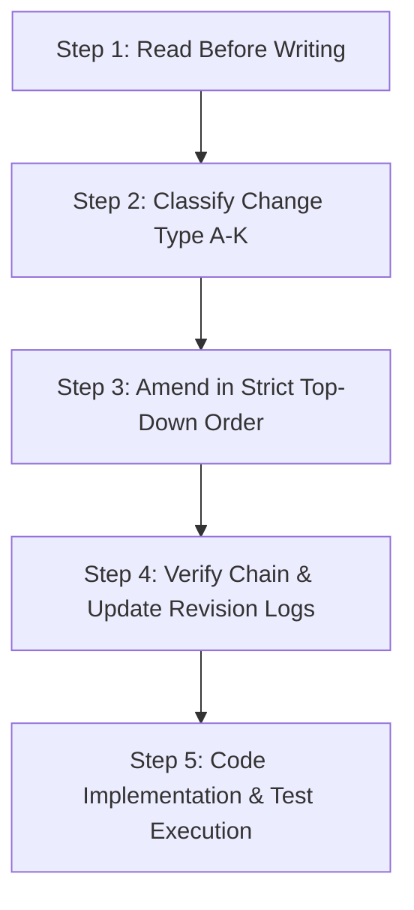

# DOC-0: Change Management Standard Operating Procedure (SOP)
## Project: RentalHub (`rentalhub`)

---

## 1. Purpose & Governance Scope
This Standard Operating Procedure (SOP) defines the mandatory protocol for modifying, expanding, and maintaining documentation and code across the **RentalHub** software ecosystem. 

RentalHub is an enterprise multi-platform system comprising:
1. **RentalHub Mobile Application**: A single Android Flutter application serving both **Customer** and **Owner** roles with permanent role-locking at onboarding, local offline caching, digital contract signing, and direct WhatsApp integrations.
2. **RentalHub Admin Web Panel**: A Flutter Web application hosted on **cPanel** for the single `super_admin` controlling shop verifications, fraud blacklists, dispute resolutions, and subscription plans.
3. **Backend Cloud Infrastructure**: Cloud Firestore, Firebase Authentication (Google Auth + Email/Password), Firebase Cloud Storage / cPanel REST authenticated media storage, Firebase Cloud Functions (FCM push triggers and server-side Meta WhatsApp Cloud API dispatch).

To prevent architectural drift, schema mismatches, breaking API contracts, or silent regressions, **every technical modification must strictly adhere to the top-down change propagation protocol established in this document.**

---

## 2. Document Registry
The RentalHub documentation pack is structured into 12 authoritative, hierarchical artifacts residing in `.ai/`.

| Doc ID | File Name | Document Title | Primary Scope | Authority Level |
| :--- | :--- | :--- | :--- | :--- |
| **DOC-0** | `doc0_change_management_sop.md` | Change Management SOP | Documentation governance & change protocol | Meta-Governance |
| **DOC-1** | `doc1_rentalhub_product_requirements_document.md` | Product Requirements Document (PRD) | Business requirements, user stories, personas, scope | Level 1 (Source of Truth) |
| **DOC-2** | `doc2_rentalhub_consolidated_architectural_design_document.md` | Consolidated Architectural Design (ADD) | System topology, Clean Architecture, DI, routing, security | Level 2 (Architecture) |
| **DOC-3** | `doc3_rentalhub_database_design_schema_specification.md` | Database Design Schema Specification | Firestore models, offline cache schemas, indexes, security rules | Level 3 (Data Layer) |
| **DOC-4** | `doc4_rentalhub_app_flow_document.md` | App Flow Document | Route transitions, screen inventories, state machines, edge cases | Level 3 (Interaction Layer) |
| **DOC-5** | `doc5_rentalhub_implementation_plan.md` | Master Implementation Plan | Phase 0–4 milestones, dependencies, WBS, risk mitigation | Level 4 (Execution Master) |
| **DOC-6** | `doc6_ui_design_instructions_for_stitch.md` | UI Design Instructions for Stitch | Design tokens, light/dark themes, custom header, AI UI prompts | Level 4 (Design System) |
| **DOC-7** | `doc7_phase_0_detailed_implementation_plan.md` | Phase 0 Detailed Implementation Plan | Environment, DI, base themes, cPanel API client, base routing | Level 5 (Phase 0 Execution) |
| **DOC-8** | `doc8_phase_1_detailed_implementation_plan.md` | Phase 1 Detailed Implementation Plan | Auth, role onboarding, KYC upload, shop listing, base tests | Level 5 (Phase 1 Execution) |
| **DOC-9** | `doc9_phase_2_detailed_implementation_plan.md` | Phase 2 Detailed Implementation Plan | Fleet CRUD, booking state machine, manual payments, approvals | Level 5 (Phase 2 Execution) |
| **DOC-10** | `doc10_phase_3_detailed_implementation_plan.md` | Phase 3 Detailed Implementation Plan | Offline handover, digital signatures, A4 PDF, Meta WhatsApp API | Level 5 (Phase 3 Execution) |
| **DOC-11** | `doc11_phase_4_detailed_implementation_plan.md` | Phase 4 Detailed Implementation Plan | Admin Web (cPanel), blacklist tribunal, QA overflow tests, release | Level 5 (Phase 4 Execution) |

---

## 3. Change Classification Matrix
Every proposed modification belongs to one of 11 distinct change classes. Modifications must cascade through all lower-tier documents in the dependency chain.

| Change Type | Impact Area | Trigger Example | Mandatory Cascading Chain | Required Approval |
| :--- | :--- | :--- | :--- | :--- |
| **Type A** | Vision & Core Scope | Adding iOS target or third-party automated payment gateway | DOC-1 ➔ DOC-2 ➔ DOC-3 ➔ DOC-4 ➔ DOC-5 ➔ DOC-6–11 | Lead Architect / Product Owner |
| **Type B** | User Role & Permissions | Modifying single-role immutability or adding staff sub-roles | DOC-1 ➔ DOC-2 ➔ DOC-3 ➔ DOC-4 ➔ DOC-7–11 | Lead Architect |
| **Type C** | System Topology | Switching cPanel media storage to S3 or adding Redis cache | DOC-2 ➔ DOC-3 ➔ DOC-5 ➔ DOC-7–11 | Technical Architect |
| **Type D** | Data Schema / Entity | Adding odometer verification photos or custom fee line items | DOC-3 ➔ DOC-2 ➔ DOC-4 ➔ Target Phase Doc (DOC-8/9/10) | Database Lead |
| **Type E** | Screen Flow & Navigation | Adding an intermediate step in manual payment confirmation | DOC-4 ➔ DOC-6 ➔ Target Phase Doc (DOC-8/9/10) | UI/UX Lead |
| **Type F** | Design System & Theming | Changing primary brand gradient, dark theme surface colors | DOC-6 ➔ DOC-2 ➔ DOC-7 ➔ Target Phase Doc | UI/UX Designer |
| **Type G** | External API Contracts | Modifying Meta Cloud WhatsApp templates or cPanel upload spec | DOC-2 ➔ DOC-3 ➔ DOC-10 ➔ DOC-11 | Integration Engineer |
| **Type H** | Business Rules | Altering freemium tier from 3 cars to 5 cars or changing late fee rules | DOC-1 ➔ DOC-2 ➔ DOC-3 ➔ DOC-9 ➔ DOC-11 | Product Manager |
| **Type I** | Testing & Quality Gates | Adding strict golden test threshold or widget overflow constraints | DOC-2 ➔ DOC-5 ➔ DOC-7–11 | QA Lead |
| **Type J** | Phase Timeline & WBS | Moving digital PDF generation from Phase 3 into Phase 2 | DOC-5 ➔ DOC-9 ➔ DOC-10 | Scrum Master / Lead Dev |
| **Type K** | Granular Code Refactor | Splitting an oversized widget inside `widgets/` folder | Target Phase Doc only (e.g. DOC-8) | Senior Software Engineer |

---

## 4. Step-by-Step Change Procedure

Whenever a change is proposed, every developer and documentation specialist must execute the following four-step protocol:



### Step 1: Read Before Writing
- Before proposing any schema change, route addition, or UI restructure, the engineer must read the root governing document (DOC-1 for business logic, DOC-2 for architecture, DOC-3 for database).
- Verify if the feature or rule is already defined or deliberately scoped out.

### Step 2: Classify Change
- Identify the exact Change Type from the Classification Matrix (Section 3).
- Map the full list of impacted documents down the chain.

### Step 3: Amend in Top-Down Order
- Open and edit the highest authority document in the cascade first.
- Propagate the change downward into data models, app flows, design tokens, and phase execution plans.
- Ensure field names, data types, status enums, and API parameters match identically across all documents.

### Step 4: Verify Chain & Update Revision Logs
- Run cross-document consistency checks:
  1. *Entity Consistency*: Does the field name in DOC-3 match DOC-2 and the target Phase Doc?
  2. *Status Enum Consistency*: Do booking statuses in DOC-1 match DOC-3 and DOC-4?
  3. *Route Consistency*: Does the GoRouter route path in DOC-2 match DOC-4?
- Update the **Revision History Table** at the bottom of each modified document with:
  - Date
  - Author / Agent
  - Change Type
  - Description of Change

### Step 5: Code Implementation & Testing
- Implement the code strictly matching the updated phase plan.
- Execute unit and widget tests (including overflow prevention and Firebase mock tests).
- Code that diverges from the documentation pack is rejected in code review.

---

## 5. Anti-Patterns to Avoid

| Anti-Pattern | Description | Consequence | Remedy |
| :--- | :--- | :--- | :--- |
| **The "Silent Code Edit"** | Modifying Firestore schema or GoRouter paths directly in Dart without updating DOC-3 or DOC-4. | Breaking admin panel integration; documentation becomes obsolete. | Enforce CI lint checks; reject PRs without documentation diffs. |
| **Bottom-Up Drift** | Updating Phase 2 Detailed Plan (DOC-9) with a new booking status without updating PRD (DOC-1) or Schema (DOC-3). | Inconsistent state machine across apps; regression in Admin Web. | Strictly follow Step 3: Update DOC-1 first, then cascade down. |
| **Orphan Data Fields** | Storing fields in cPanel or Firestore that are not mapped in DOC-3 field tables. | Unindexed queries, security rule loopholes, data corruption. | Every payload must map 1:1 to DOC-3 specifications. |
| **God-File Widget Bloat** | Creating screen view files exceeding 250 lines instead of decomposing into `views/<screen>/widgets/`. | Performance lag, painful merge conflicts, unmaintainable UI code. | Decompose all cards, form fields, headers, and dialogs into dedicated files in `widgets/`. |
| **Direct API Secrets Leak** | Embedding Meta Cloud WhatsApp tokens or cPanel master secrets directly in the Android Flutter app. | Catastrophic security breach; token revocation halts production. | All third-party secrets must reside strictly in Firebase Cloud Functions environment secrets. |

---

## 6. Phase Plan Documents Synchronization SOP
Documents DOC-7 through DOC-11 represent executable phase blueprints:
- **DOC-7 (Phase 0)**: Foundation, environment, theming, Clean Architecture scaffold, DI, cPanel API client.
- **DOC-8 (Phase 1)**: Authentication, single-role onboarding wizard, KYC document upload, shop profiles.
- **DOC-9 (Phase 2)**: Fleet inventory CRUD, booking engine, manual bank payment review, status tracker.
- **DOC-10 (Phase 3)**: Offline handover engine, touch signatures, A4 PDF generation, Meta WhatsApp API.
- **DOC-11 (Phase 4)**: Admin Web on cPanel, global blacklist registry, dispute resolution, UI overflow testing, release.

If an implementation task shifts between phases (e.g. moving digital signatures from Phase 3 to Phase 2), **both phase documents (DOC-9 and DOC-10) and DOC-5 (Master Implementation Plan) must be updated simultaneously** before code execution begins.

---

## 7. Quick Reference Card

```
===================================================================================
                       RENTALHUB DOCUMENTATION GOVERNANCE
===================================================================================
1. ROOT DIRECTORY RULE     : Never generate docs in project root. ALWAYS use .ai/
2. ORDER OF TRUTH          : DOC-1 (Business) ➔ DOC-2 (Arch) ➔ DOC-3 (Data) 
                             ➔ DOC-4 (Flow) ➔ DOC-5 (Plan) ➔ DOC-6 (UI) ➔ DOC-7..11
3. NO PLACEHOLDERS         : Never leave "TODO", "TBD", or "..." in any document.
4. CODEBASE DECOMPOSITION  : Every Flutter feature MUST have:
                             - data/ (datasources, models, repositories)
                             - domain/ (entities, repositories, usecases)
                             - presentation/ (cubit, views, widgets/)
5. LEAN FILE SIZE RULE     : Keep view files < 250 lines. Decompose UI into widgets/.
6. SECURITY BOUNDARY       : Mobile app NEVER holds WhatsApp or cPanel master secrets.
===================================================================================
```

---

## 8. Document Revision History
| Version | Date | Author / Agent | Change Type | Summary of Changes |
| :--- | :--- | :--- | :--- | :--- |
| **1.0.0** | 2026-10-31 | Lead Architect (Antigravity) | Initial Creation | Initial creation of Change Management SOP for RentalHub ecosystem. |
| **1.1.0** | 2026-10-31 | Lead Architect (Antigravity) | Type F (Design System) & Type A (Product Spec) | Harmonized full documentation suite with authentic Project Requirements UI color scheme (Midnight Navy #1B1E5C & Sunset Orange #F95700) and unified domain naming (`rentalhub.pk`). |
| **1.2.0** | 2026-10-31 | Lead Architect (Antigravity) | Type F (Design System) | Expanded DOC-6 with complete Stitch prompts for all Customer, Owner, and Admin Web screens, cataloging generated assets. |
| **1.3.0** | 2026-10-31 | Lead Architect (Antigravity) | Type F (Design System) | Established 20 Core Anchor Screens Architecture & Pattern Coverage Matrix to govern execution without API exhaustion. |
| **1.4.0** | 2026-10-31 | Lead Architect (Antigravity) | Type F (Design System) | Completed 100% generation and verification of all 20 Core Anchor Screens (8 Customer, 8 Owner, 4 Admin Web) saved in `.stitch/` with responsive HTML and high-res PNG pairs. |
| **1.5.0** | 2026-11-01 | Lead Architect (Antigravity) | Type C (Topology) & Type J (Timeline & WBS) | Cascaded architectural update across DOC-5 and DOC-7 through DOC-11: explicitly codified Git & remote GitHub setup, Firebase project provisioning & Android SHA-1 fingerprint registration, and cPanel storage server deployment (PHP upload script, folder permissions, and .htaccess security) into Phase 0; mapped all 20 Stitch anchor screens to their implementation phases. |
