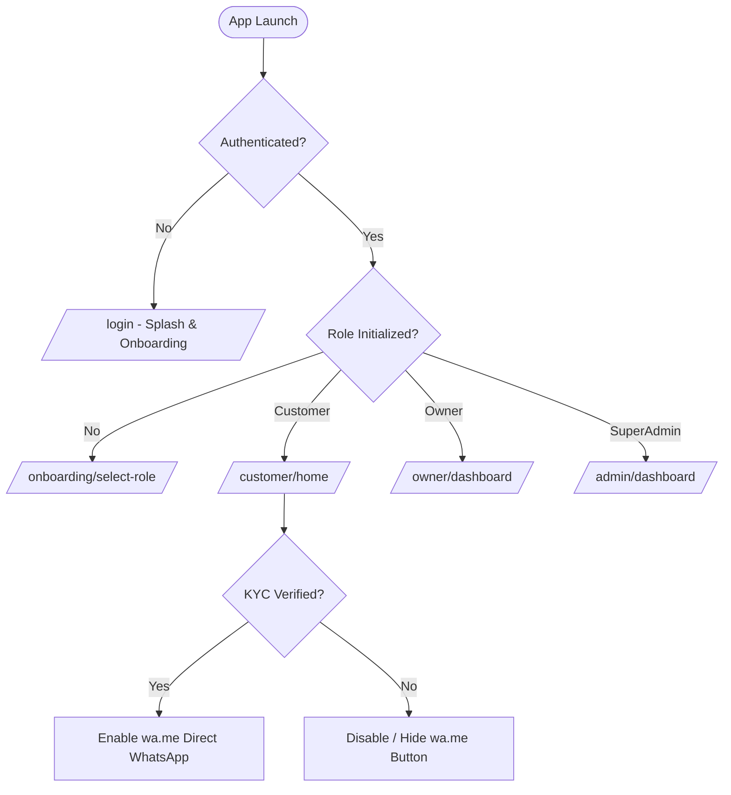
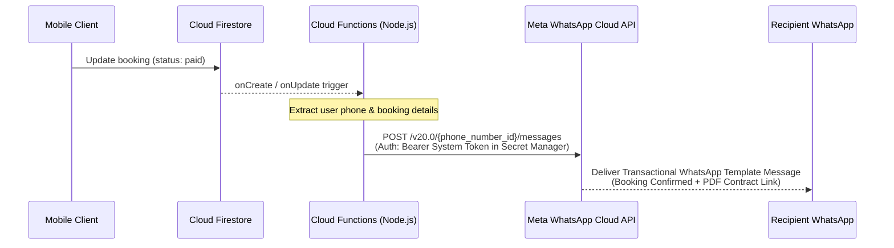

# DOC-2: Consolidated Architectural Design Document (ADD)
## Project: RentalHub (`rentalhub`)

---

## 1. Architectural Tenets & System Topology

RentalHub is architected according to four non-negotiable architectural tenets:
1. **Feature-Driven Clean Architecture**: Strict separation of concerns between `data`, `domain`, and `presentation` layers within each self-contained business feature.
2. **Offline-First Resilience**: Field operations (vehicle inspection, odometer capture, touch signature collection) function completely offline, queueing payloads in local storage and synchronizing automatically upon network reconnection.
3. **Zero Secrets in Mobile Client**: Sensitive third-party API credentials (Meta Cloud WhatsApp tokens, cPanel storage master keys) reside strictly within server-side **Firebase Cloud Functions**.
4. **Modular Widget Decomposition**: Presentation views must never exceed 250 lines; all UI cards, headers, form sheets, and dialogs are decomposed into granular components inside `views/<screen>/widgets/` or `core/widgets/`.

### 1.1 High-Level System Topology

```mermaid
flowchart TB
    subgraph ClientLayer ["Client Applications (Flutter Dart)"]
        MobileApp["RentalHub Android App\n(Customer & Owner Single App)\n[GoRouter, Cubit, Offline Sync]"]
        AdminWeb["RentalHub Admin Panel\n(Flutter Web on cPanel)\n[Single Super Admin]"]
    end

    subgraph FirebaseLayer ["Firebase Cloud Backend"]
        FirebaseAuth["Firebase Authentication\n(Google Sign-In & Email/Password)"]
        Firestore["Cloud Firestore\n(NoSQL Realtime Database)"]
        CloudFunctions["Firebase Cloud Functions\n(Node.js Serverless Execution)"]
        FCM["Firebase Cloud Messaging (FCM)\n(Push Notifications)"]
    end

    subgraph ExternalServices ["External Infrastructure"]
        cPanelStorage["cPanel Secure Storage API\n(PHP REST Token-Gated Endpoint)\n[Private Media: KYC, Photos, PDFs]"]
        MetaWhatsApp["Meta WhatsApp Cloud API\n(Transactional Notifications & PDF links)"]
    end

    MobileApp -->|Auth Tokens| FirebaseAuth
    MobileApp -->|Realtime Streams & CRUD| Firestore
    MobileApp -->|Multipart Upload & Signed Get| cPanelStorage
    MobileApp -->|Offline Fallback| LocalCache[("Local SQLite/Hive\nOffline Cache")]

    AdminWeb -->|Auth (Super Admin)| FirebaseAuth
    AdminWeb -->|Admin CRUD| Firestore
    AdminWeb -->|Audit / View Documents| cPanelStorage

    Firestore -->|Document Triggers| CloudFunctions
    CloudFunctions -->|Dispatch Push Alerts| FCM
    CloudFunctions -->|Send WhatsApp Templates| MetaWhatsApp
    FCM -->|Push Banners| MobileApp
```

---

## 2. Workspace & Project Structure

The project structure directly mirrors the production-tested pattern from the reference codebase (`E:\Commercial\RentACar\lib`), organized into `core/` and `features/`:

```
rentalhub/
├── android/                         # Native Android configuration
├── web/                             # Flutter Web shell for cPanel deployment
├── assets/
│   ├── icons/                       # Brand and adaptive launcher icons
│   ├── images/                      # Vector illustrations & vehicle silhouettes
│   └── fonts/                       # Custom typography (Inter / Noto Nastaliq Urdu)
└── lib/
    ├── firebase_options.dart        # FlutterFire initialization options
    ├── main.dart                    # Application entrypoint & multi-environment runner
    │
    ├── core/                        # Global foundational modules
    │   ├── constants/               # Colors, dimensions, asset paths, API endpoints
    │   ├── di/                      # Dependency Injection container (GetIt)
    │   ├── error/                   # Failures, exceptions, error mapper
    │   ├── network/                 # HTTP client, auth interceptor, cPanel client
    │   ├── routing/                 # GoRouter configuration, route guards, redirectors
    │   ├── services/                # Local storage service, location service, sync engine
    │   ├── storage/                 # Local database (Hive/SQLite) adapters & keys
    │   ├── theme/                   # Light & Dark theme data, color tokens, typography
    │   ├── utils/                   # Formatters, date helpers, validators, debouncers
    │   └── widgets/                 # Global UI primitives (buttons, inputs, headers, badges)
    │
    └── features/                    # Feature modules (Clean Architecture)
        ├── auth/                    # Authentication & Single-Role Onboarding
        ├── discovery/               # Customer shop exploration, map radius & catalog
        ├── fleet/                   # Owner vehicle CRUD, packages & rates management
        ├── bookings/                # Booking engine, request queue, status tracker
        ├── payments/                # Manual transfer upload, verification & payout accounts
        ├── handover/                # Vehicle inspection, touch canvas signatures, A4 PDF
        ├── trust/                   # KYC document management, customer rating & SOS
        ├── blacklist/               # Instant fraud registry, lookup & admin reversal
        ├── subscription/            # Freemium (3 cars) and paid tier management
        └── admin/                   # Flutter Web super admin dashboard modules
```

---

## 3. Architecture Pattern & Layer Boundaries

Each feature folder strictly implements **Clean Architecture** partitioned into three autonomous layers:

```
features/<feature_name>/
├── data/
│   ├── datasources/                 # Remote (Firestore/cPanel) & Local (Hive/SQLite) datasources
│   ├── models/                      # DTO models with fromFirestore, toFirestore, fromJson
│   └── repositories/                # Implementation of domain repository interfaces
├── domain/
│   ├── entities/                    # Immutable business entities (pure Dart)
│   ├── repositories/                # Abstract repository contracts
│   └── usecases/                    # Single-responsibility business use cases
└── presentation/
    ├── cubit/                       # State management (Bloc/Cubit + State classes)
    └── views/                       # Screen widgets (< 250 lines)
        └── widgets/                 # Granular decomposed component widgets
```

### 3.1 Layer Responsibilities & Rules
1. **Domain Layer**: Contains pure business rules with zero Flutter dependencies (`flutter/material.dart` forbidden). Entities are immutable Dart classes.
2. **Data Layer**: Manages data retrieval and conversion. Implements repository interfaces defined in the domain layer. Handles caching strategies and mapping raw Firestore documents or JSON responses to domain entities.
3. **Presentation Layer**: Manages UI rendering and state transitions via `flutter_bloc` / `cubit`. UI views are kept declarative and lightweight. All user interaction logic triggers cubit methods.

---

## 4. Technology Stack & Justification Matrix

| Component | Technology | Version | Architectural Justification |
| :--- | :--- | :--- | :--- |
| **Framework** | Flutter | 3.24+ | Single codebase for Android mobile and cPanel-hosted Web Admin. High performance Skia/Impeller graphics. |
| **Language** | Dart | 3.5+ | Sound null-safety, records, pattern matching, strong typing. |
| **State Management** | `flutter_bloc` (Cubit) | ^9.1.1 | Predictable unidirectional data flow, testable state transitions, separation of UI and business logic. |
| **Dependency Injection** | `get_it` | ^9.3.0 | Lightweight service locator allowing clean inversion of control and mock substitution in tests. |
| **Routing** | `go_router` | ^18.1.0 | Declarative URL routing, nested navigation shells, robust redirect guards for authentication and role locking. |
| **Auth** | `firebase_auth` & `google_sign_in` | ^7.0.0 / ^7.2.0 | Out-of-the-box OAuth2 Google sign-in and encrypted email/password authentication. |
| **Database** | `cloud_firestore` | ^7.0.0 | Offline persistence, realtime stream listeners for instant booking alerts, serverless scalability. |
| **Cloud Functions** | `firebase-functions` (Node.js) | v5.0+ | Server-side execution of Meta WhatsApp Graph API calls and secure push notification dispatch. |
| **Media Storage** | cPanel REST API (PHP backend) | Custom | Cost-effective, high-capacity file hosting for large photos/PDFs with custom token-authenticated access. |
| **Offline Cache** | `shared_preferences` & `hive` | ^2.5.6 / ^2.2.3 | Fast key-value and NoSQL binary storage for offline inspection forms, signature vectors, and sync queues. |
| **PDF Generation** | `pdf` & `printing` | ^3.11.1 | On-device rendering of printable A4 digital rental contracts complete with embedded photos and signatures. |
| **Location & Maps** | `geolocator` | ^14.0.0 | Precise user GPS retrieval for shop distance calculations and radius filtering (1–5 km). |
| **OCR & Scanning** | `google_mlkit_text_recognition` | ^0.13.0 | Client-side on-device OCR for rapid parsing of CNIC numbers and driving license dates. |

---

## 5. Client Routing & Role Guard Architecture

Navigation is governed by **GoRouter** with an active redirection engine evaluating user session state:



### 5.1 Route Tree Specification
* `/splash` - Brand splash screen and environment validator.
* `/auth` - Google Sign-In and Email/Password login view.
* `/onboarding/role` - Compulsory role selection (Customer vs Owner). Once submitted, role is immutable.
* `/onboarding/profile` - Profile completion (Name, WhatsApp number, photo).
* **Customer Routes (`/customer`)**:
  - `/customer/home` - Geo-discovery dashboard, radius filter (1–5 km), shop map/list.
  - `/customer/shop/:id` - Shop details, available fleet categories, ratings.
  - `/customer/vehicle/:id` - Vehicle specs, self-drive/with-driver rate cards, booking form.
  - `/customer/bookings` - My Bookings tracker (Requested, Approved, Paid, Active, Completed).
  - `/customer/payment/:bookingId` - Owner bank account details, screenshot upload, TxID input.
  - `/customer/agreement/:bookingId` - View & download signed A4 rental agreement PDF.
  - `/customer/profile` - KYC document manager, saved shops, English/Urdu toggle, Emergency SOS.
* **Owner Routes (`/owner`)**:
  - `/owner/dashboard` - Active rentals counter, revenue overview, fleet status breakdown.
  - `/owner/fleet` - Fleet inventory CRUD, daily/hourly rates, in-city/out-of-city toggles.
  - `/owner/requests` - Incoming customer reservation requests, customer trust score audit.
  - `/owner/payment-review/:bookingId` - Verify customer payment screenshot and confirm TxID.
  - `/owner/handover/:bookingId` - Digital inspection form, damage markers, dual touch signatures.
  - `/owner/return/:bookingId` - Return inspection, fuel/mileage settlement, customer rating.
  - `/owner/blacklist/add` - Instant customer fraud reporting form.
* **Admin Routes (`/admin` - Flutter Web)**:
  - `/admin/login` - Dedicated super admin login.
  - `/admin/dashboard` - Global metrics, revenue, active fleet.
  - `/admin/shops` - Shop verification approval queue and document inspector.
  - `/admin/blacklist` - Central fraud registry with search and revert controls.
  - `/admin/disputes` - Platform dispute tribunal.
  - `/admin/subscriptions` - Shop subscription tiers and quota management.

---

## 6. Offline Persistence & Background Synchronization Engine

To guarantee zero data loss during basement vehicle handovers:

1. **Storage Mechanism**: Inspection state, vehicle checklist items, damage quadrant markers, and signature vector points are serialized into local **Hive boxes** (`handover_box`).
2. **Sync Queue Engine**:
   - Every offline operation is appended to an internal FIFO `SyncQueue`.
   - A `ConnectivityService` listens to network state changes using `connectivity_plus`.
   - When connectivity shifts to active, the `SyncEngine` sequentially:
     1. Uploads captured damage photos and inspection photos to the cPanel storage endpoint with exponential retry backoff.
     2. Compiles and uploads the signed A4 PDF agreement.
     3. Commits the transaction to Cloud Firestore (`status: on_trip`).
     4. Dispatches the WhatsApp PDF download link via Cloud Functions.
     5. Purges the synced item from the local queue.

---

## 7. cPanel Secure Storage Architecture

RentalHub adopts a hybrid cloud strategy: Cloud Firestore for realtime metadata, and a dedicated **cPanel PHP REST API** for cost-effective, high-capacity file hosting.

### 7.1 Security & Private Access Protocol
* **Uploading**: The Flutter app sends a `multipart/form-data` POST request to `https://storage.rentalhub.pk/api/upload.php` with an authorization Bearer token generated using HMAC-SHA256 based on the active Firebase Auth user UID and timestamp.
* **Private Serving**: Files uploaded to `uploads/kyc/`, `uploads/payments/`, and `uploads/agreements/` are protected via `.htaccess` to prevent public directory traversal and web crawling.
* **In-App Media Access**: To display an image or download an agreement PDF, the app requests a short-lived **Signed Media URL** (valid for 15 minutes) or loads images via an authenticated HTTP header interceptor inside `cached_network_image`.

---

## 8. Meta WhatsApp Cloud API Architecture



* **Zero Token Exposure**: The Meta System User Permanent Token and Phone Number ID are stored in **Google Cloud Secret Manager** accessible only by Cloud Functions.
* **Template Standardization**: Pre-approved Meta templates for:
  - `booking_request_received_owner`
  - `booking_approved_customer`
  - `payment_verified_pickup_ready`
  - `rental_agreement_pdf_dispatch`
  - `return_settlement_receipt`

---

## 9. Design System, Theming & UI Dimensions

The UI design strictly adheres to the **authentic Project Requirements UI color scheme** (from `.ai/project_requirements_ui/`), while maintaining the screen dimensions and curved top header established in [ui_ref.jpg](file:///e:/Commercial/Gari%20App/.ai/project_requirements_ui/ui_ref.jpg).

### 9.1 Dimensional & Header Foundations
* **Immersive Full-Screen**: Status bar transparent with `SystemUiOverlayStyle`.
* **Custom Curved App Bar (`CustomCurvedHeader`)**:
  - Gradient background: Deep midnight navy (`#16194F` to `#242875`) in light mode; Deep obsidian midnight navy (`#0B0D26` to `#16194F`) in dark mode.
  - Bottom radius: Curved sweep with `BorderRadius.vertical(bottom: Radius.circular(28))`.
  - Integrated header widgets: Profile avatar with verified badge, greeting text ("Hi, [Name]"), search icon, notification bell with orange badge, and action trigger.
  - Floating Card Overlap: Content cards feature a negative top margin (`-24.0`) to elegantly overlap the curved header baseline.

### 9.2 Light & Dark Theme Color Tokens

| Token Name | Light Theme Color | Dark Theme Color | Usage |
| :--- | :--- | :--- | :--- |
| `primary` | `#1B1E5C` (Royal Navy Blue) | `#252B7A` (Deep Royal Navy) | Primary brand color, headers, title bars |
| `primaryContainer` | `#EEF0FF` (Lavender Mist) | `#1A1D42` (Muted Navy Container) | Selected chips, pill badges |
| `secondary` | `#F95700` (Vibrant Sunset Orange) | `#FF6D24` (Bright Orange) | CTAs, "Book Now", "Pay Advance" action buttons |
| `surface` | `#FFFFFF` (Pure White) | `#13152C` (Midnight Charcoal Surface) | Screen cards, dialog surfaces |
| `background` | `#F8FAFC` (Slate Off-White) | `#0A0B1A` (Midnight Dark Background) | Scaffold background |
| `onSurface` | `#0F172A` (Slate 900) | `#F8FAFC` (Slate 50) | Primary typography |
| `onSurfaceVariant` | `#64748B` (Slate 500) | `#94A3B8` (Slate 400) | Subtitles, disabled hints |
| `error` | `#EF4444` (Crimson Red) | `#F87171` (Coral Red) | Blacklist banners, validation errors |
| `success` | `#10B981` (Emerald Green) | `#34D399` (Bright Mint) | Verified badges, payment approved |


---

## 10. Testing & Quality Assurance Architecture

To satisfy all project testing requirements:

1. **UI Overflow Guards**:
   - Automated widget test harness wrapping all views in varied viewport dimensions (Small: 360x640, Medium: 393x852, Large: 412x915).
   - Dynamic font scale tests rendering views at `textScaler: TextScaler.linear(1.35)` to verify no yellow/black striped overflow exceptions occur.
   - Keyboard overlay tests injecting virtual keyboards (`bottomInset: 350`) to ensure all forms scroll cleanly without clipping buttons.
2. **Button Responsiveness & Debouncing**:
   - Custom `DebouncedButton` widget enforcing a 400ms lockout to eliminate double-booking or duplicate payment proof submissions.
   - Widget tests validating single event emission upon multiple rapid taps.
3. **Firebase & cPanel Data Integration Tests**:
   - Mock Firestore repositories utilizing `fake_cloud_firestore` validating model serialization, nullability safety, and security rules.
   - Mock HTTP cPanel client testing multipart upload error codes (401 Unauthorized, 413 File Too Large, 500 Server Error) and retry backoff.

---

## 11. Document Revision History
| Version | Date | Author / Agent | Change Type | Summary of Changes |
| :--- | :--- | :--- | :--- | :--- |
| **1.0.0** | 2026-10-31 | Lead Architect (Antigravity) | Initial Creation | Complete Consolidated Architectural Design Document for RentalHub. |
