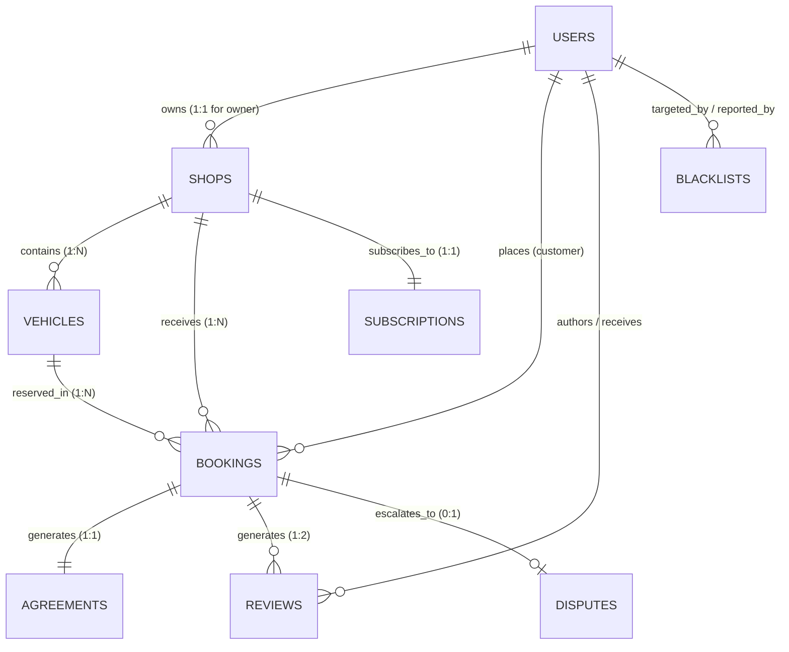
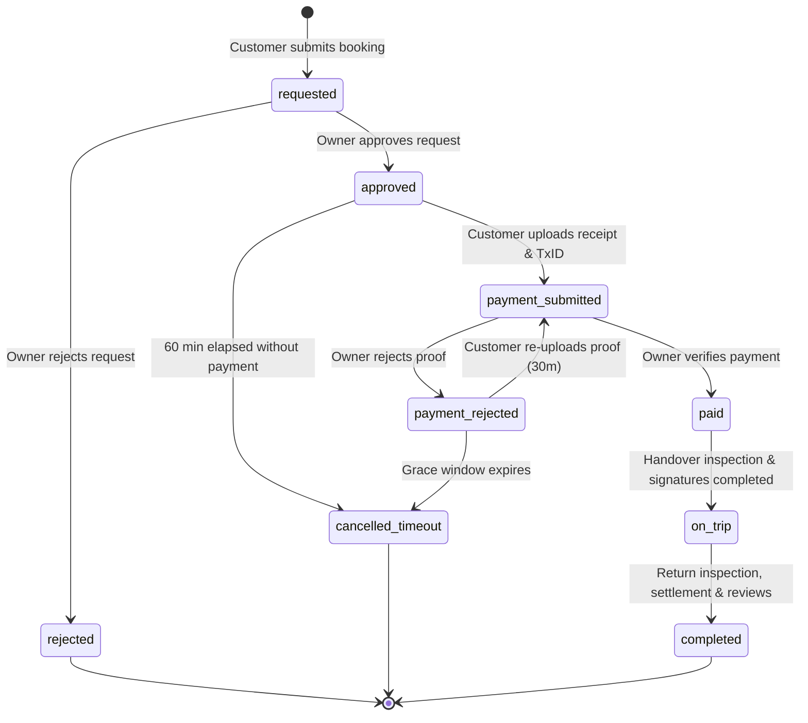

# DOC-3: Database Design & Schema Specification
## Project: RentalHub (`rentalhub`)

---

## 1. Database Architecture & Paradigm Overview
RentalHub utilizes a hybrid data persistence model:
1. **Cloud Firestore (Primary Cloud Store)**: Fully managed, serverless, document-oriented NoSQL database providing realtime synchronization, offline caching for read queries, and strong horizontal scalability.
2. **Local Cache Engine (Offline Persistence)**: Local binary NoSQL store powered by **Hive** and **SQLite** for storing field inspection drafts, photo queues, and touch signature vectors in areas with zero connectivity.
3. **cPanel Media Directory**: Direct file storage for high-resolution images, CNIC scans, and compiled PDF contracts, referenced in Firestore documents via relative storage keys and signed URL endpoints.

---

## 2. Entity-Relationship (ER) Topology Diagram



---

## 3. Core Cloud Firestore Collections & Specifications

### 3.1 Collection: `users`
Represents all registered platform actors (Customers and Owners).

| Field Name | Data Type | Nullable | Default | Description & Constraints |
| :--- | :--- | :---: | :---: | :--- |
| `uid` | String | No | None | Firebase Auth User ID (Document Key). |
| `role` | String | No | None | Immutable role: `'customer'` or `'owner'`. Locked at onboarding. |
| `email` | String | No | None | User's verified email address. |
| `full_name` | String | No | None | Display name of the user. |
| `phone_number` | String | No | None | WhatsApp contact with country code (`+923XXXXXXXXX`). |
| `profile_photo_url` | String | Yes | `null` | Path or URL to avatar on cPanel storage. |
| `is_verified` | Boolean | No | `false` | True when CNIC and driving license are approved. |
| `cnic_number` | String | Yes | `null` | 13-digit Pakistani National ID (`XXXXX-XXXXXXX-X`). |
| `cnic_front_url` | String | Yes | `null` | Secure storage key for CNIC front image. |
| `cnic_back_url` | String | Yes | `null` | Secure storage key for CNIC back image. |
| `license_number` | String | Yes | `null` | Driving license identifier. |
| `license_url` | String | Yes | `null` | Secure storage key for driving license image. |
| `trust_score` | Number | No | `5.0` | Computed average customer rating (1.0 to 5.0). |
| `total_trips` | Integer | No | `0` | Total completed rental trips. |
| `is_blacklisted` | Boolean | No | `false` | Global fraud blacklist indicator. |
| `created_at` | Timestamp | No | `request.time` | Account registration timestamp. |
| `updated_at` | Timestamp | No | `request.time` | Last profile update timestamp. |

---

### 3.2 Collection: `shops`
Represents physical rental business entities registered by Owners.

| Field Name | Data Type | Nullable | Default | Description & Constraints |
| :--- | :--- | :---: | :---: | :--- |
| `shop_id` | String | No | None | Unique Shop ID (Document Key). |
| `owner_id` | String | No | None | Foreign Key referencing `users.uid`. |
| `shop_name` | String | No | None | Registered legal / brand name of shop. |
| `phone_number` | String | No | None | Primary business telephone / WhatsApp. |
| `address` | String | No | None | Physical shop street address. |
| `city` | String | No | None | City name (e.g. `'Lahore'`, `'Karachi'`, `'Islamabad'`). |
| `geo_location` | GeoPoint | No | None | Latitude and Longitude for radius queries. |
| `is_verified` | Boolean | No | `false` | Verified status conferred by Super Admin. |
| `operating_hours`| String | No | `'9am-10pm'`| Daily business operating hours. |
| `bank_accounts` | Array[Map] | No | `[]` | List of owner payout accounts (Max 3 maps). |
| `bank_accounts[i].type` | String | No | None | Account type: `'jazzcash'`, `'easypaisa'`, or `'bank'`. |
| `bank_accounts[i].title`| String | No | None | Account title matching business/owner name. |
| `bank_accounts[i].number`| String | No | None | Mobile number or 24-character IBAN. |
| `active_fleet_count`| Integer | No | `0` | Current number of active vehicle listings. |
| `subscription_tier` | String | No | `'basic'` | Current tier: `'basic'`, `'pro'`, or `'enterprise'`. |
| `rating` | Number | No | `5.0` | Average public shop rating from customers. |
| `created_at` | Timestamp | No | `request.time` | Shop registration timestamp. |

---

### 3.3 Collection: `vehicles`
Represents individual rental cars managed in a shop's fleet.

| Field Name | Data Type | Nullable | Default | Description & Constraints |
| :--- | :--- | :---: | :---: | :--- |
| `vehicle_id` | String | No | None | Unique Vehicle ID (Document Key). |
| `shop_id` | String | No | None | Foreign Key referencing `shops.shop_id`. |
| `make` | String | No | None | Manufacturer (e.g. `'Toyota'`, `'Honda'`). |
| `model` | String | No | None | Model name (e.g. `'Corolla'`, `'Civic'`). |
| `year` | Integer | No | None | Manufacturing year (e.g. `2022`). |
| `category` | String | No | None | Enum: `'sedan'`, `'suv'`, `'hatchback'`, `'hiace'`, `'luxury'`. |
| `transmission` | String | No | None | Enum: `'automatic'` or `'manual'`. |
| `fuel_type` | String | No | None | Enum: `'petrol'`, `'diesel'`, `'hybrid'`, `'electric'`. |
| `seating_capacity` | Integer | No | `5` | Total passenger seating capacity. |
| `registration_number`| String | No | None | License plate number (e.g. `'LEA-21-4920'`). |
| `images` | Array[String]| No | `[]` | Array of image storage keys on cPanel. |
| `rates_self_drive` | Map | No | None | Rates when customer drives. |
| `rates_self_drive.hourly_1`| Integer| Yes | `null` | 1-hour package rate in PKR. |
| `rates_self_drive.hourly_3`| Integer| Yes | `null` | 3-hour package rate in PKR. |
| `rates_self_drive.hourly_6`| Integer| Yes | `null` | 6-hour package rate in PKR. |
| `rates_self_drive.daily_24`| Integer| No | None | 24-hour full-day in-city rate in PKR. |
| `rates_self_drive.out_of_city`| Integer| Yes| `null`| Out-of-city daily rate in PKR. |
| `rates_with_driver` | Map | No | None | Rates with shop driver provided. |
| `rates_with_driver.daily_24`| Integer| No | None | 24-hour full-day with-driver rate in PKR. |
| `status` | String | No | `'available'`| Enum: `'available'`, `'on_rent'`, `'maintenance'`, `'inactive'`. |
| `is_active` | Boolean | No | `true` | Visibility toggle in shop catalog. |
| `created_at` | Timestamp | No | `request.time` | Listing creation timestamp. |

---

### 3.4 Collection: `bookings`
Core operational transaction entity managing rental reservations.

| Field Name | Data Type | Nullable | Default | Description & Constraints |
| :--- | :--- | :---: | :---: | :--- |
| `booking_id` | String | No | None | 6-8 digit alphanumeric booking identifier. |
| `customer_id` | String | No | None | Foreign Key referencing `users.uid`. |
| `shop_id` | String | No | None | Foreign Key referencing `shops.shop_id`. |
| `vehicle_id` | String | No | None | Foreign Key referencing `vehicles.vehicle_id`. |
| `package_type` | String | No | None | Enum: `'1_hour'`, `'3_hours'`, `'6_hours'`, `'24_hours'`. |
| `is_with_driver` | Boolean | No | `false` | True for chauffeur-driven, false for self-drive. |
| `pickup_datetime` | Timestamp | No | None | Scheduled vehicle collection time. |
| `return_datetime` | Timestamp | No | None | Scheduled return time. |
| `total_amount` | Integer | No | None | Gross rental fee in PKR. |
| `advance_required`| Integer | No | None | Mandatory advance deposit (e.g. PKR 1,000). |
| `advance_paid` | Integer | No | `0` | Confirmed advance payment amount. |
| `remaining_balance`| Integer | No | None | Due balance upon vehicle collection. |
| `status` | String | No | `'requested'` | Booking state machine (detailed in Section 5). |
| `payment_proof_url`| String | Yes | `null` | Storage key for uploaded payment screenshot. |
| `transaction_id` | String | Yes | `null` | Customer-entered transaction reference / TxID. |
| `payment_verified_at`| Timestamp| Yes | `null` | Timestamp when owner approved payment proof. |
| `rejection_reason` | String | Yes | `null` | Reason if request or payment was rejected. |
| `agreement_id` | String | Yes | `null` | Foreign Key referencing `agreements.agreement_id`. |
| `created_at` | Timestamp | No | `request.time` | Reservation creation timestamp. |
| `updated_at` | Timestamp | No | `request.time` | Last status modification timestamp. |

---

### 3.5 Collection: `agreements`
Represents the finalized digital legal contract and vehicle inspection record.

| Field Name | Data Type | Nullable | Default | Description & Constraints |
| :--- | :--- | :---: | :---: | :--- |
| `agreement_id` | String | No | None | Contract identifier (Document Key). |
| `booking_id` | String | No | None | Foreign Key referencing `bookings.booking_id`. |
| `pdf_url` | String | No | None | Secure storage key for generated A4 PDF agreement. |
| `customer_signature_url`| String | No | None | Storage key for customer signature vector image. |
| `owner_signature_url` | String | No | None | Storage key for owner signature vector image. |
| `handover_odometer` | Integer | No | None | Odometer reading at dispatch. |
| `handover_fuel_level`| String | No | None | Enum: `'25%'`, `'50%'`, `'75%'`, `'100%'`. |
| `return_odometer` | Integer | Yes | `null` | Odometer reading at return. |
| `return_fuel_level` | String | Yes | `null` | Return fuel level enum. |
| `damage_markers` | Array[Map] | No | `[]` | Quadrant coordinates + damage notes. |
| `inspection_photos` | Array[String]| No | `[]` | Odometer, fuel, and vehicle inspection photos. |
| `signed_at` | Timestamp | No | `request.time` | Timestamp of digital execution. |

---

### 3.6 Collection: `blacklists`
Community fraud prevention registry.

| Field Name | Data Type | Nullable | Default | Description & Constraints |
| :--- | :--- | :---: | :---: | :--- |
| `blacklist_id` | String | No | None | Unique record identifier (Document Key). |
| `customer_uid` | String | Yes | `null` | Foreign Key referencing `users.uid` if known. |
| `cnic_number` | String | No | None | 13-digit CNIC of blacklisted person (Indexed). |
| `phone_number` | String | No | None | Phone number of offender (Indexed). |
| `reported_by_shop_id`| String | No | None | Foreign Key referencing `shops.shop_id`. |
| `reason_category` | String | No | None | Enum: `'absconding'`, `'unpaid_debt'`, `'severe_damage'`, `'fake_documents'`. |
| `description` | String | No | None | Factual incident narrative. |
| `evidence_urls` | Array[String]| No | `[]` | Storage keys for supporting photos/police FIR. |
| `is_active` | Boolean | No | `true` | True = currently blacklisted. |
| `reverted_by_admin`| String | Yes | `null` | Super Admin UID who reverted the record. |
| `reverted_reason` | String | Yes | `null` | Audit justification for blacklist reversal. |
| `created_at` | Timestamp | No | `request.time` | Blacklist creation timestamp. |

---

### 3.7 Collection: `reviews`
Dual-sided feedback and reputation scores.

| Field Name | Data Type | Nullable | Default | Description & Constraints |
| :--- | :--- | :---: | :---: | :--- |
| `review_id` | String | No | None | Unique review identifier. |
| `booking_id` | String | No | None | Reference to `bookings.booking_id`. |
| `reviewer_uid` | String | No | None | User UID who authored the review. |
| `target_uid` | String | No | None | User UID being rated. |
| `reviewer_role` | String | No | None | `'customer_to_shop'` or `'owner_to_customer'`. |
| `rating_shop` | Number | Yes | `null` | 1–5 stars (Customer rating shop service). |
| `rating_vehicle` | Number | Yes | `null` | 1–5 stars (Customer rating vehicle state). |
| `rating_car_care`| Number | Yes | `null` | 1–5 stars (Owner rating customer vehicle care). |
| `rating_on_time` | Number | Yes | `null` | 1–5 stars (Owner rating customer return timeliness). |
| `rating_payment` | Number | Yes | `null` | 1–5 stars (Owner rating payment reliability). |
| `rating_behavior`| Number | Yes | `null` | 1–5 stars (Owner rating customer conduct). |
| `quick_tags` | Array[String]| No | `[]` | Tags: `['Returned Clean', 'Paid on time', etc.]`. |
| `comment` | String | Yes | `null` | Freeform text review. |
| `created_at` | Timestamp | No | `request.time` | Review submission timestamp. |

---

### 3.8 Collection: `subscriptions`
Tracks fleet tier quotas per shop.

| Field Name | Data Type | Nullable | Default | Description & Constraints |
| :--- | :--- | :---: | :---: | :--- |
| `subscription_id`| String | No | None | Unique subscription identifier. |
| `shop_id` | String | No | None | Foreign Key referencing `shops.shop_id`. |
| `tier` | String | No | `'basic'` | Enum: `'basic'`, `'pro'`, `'enterprise'`. |
| `max_fleet_cars` | Integer | No | `3` | Maximum active vehicle slots (Basic: 3, Pro: 15, Enterprise: 999). |
| `is_active` | Boolean | No | `true` | Subscription validity status. |
| `start_date` | Timestamp | No | `request.time` | Plan activation date. |
| `end_date` | Timestamp | Yes | `null` | Expiry date (`null` for perpetual free basic). |
| `created_at` | Timestamp | No | `request.time` | Creation timestamp. |

---

### 3.9 Collection: `disputes`
Customer and Owner arbitration claims.

| Field Name | Data Type | Nullable | Default | Description & Constraints |
| :--- | :--- | :---: | :---: | :--- |
| `dispute_id` | String | No | None | Unique dispute identifier. |
| `booking_id` | String | No | None | Foreign Key referencing `bookings.booking_id`. |
| `complainant_uid`| String | No | None | UID of complaining user. |
| `complainant_role`| String | No | None | `'customer'` or `'owner'`. |
| `category` | String | No | None | Enum: `'overcharge'`, `'car_damaged'`, `'deposit_issue'`, `'rude_behavior'`. |
| `description` | String | No | None | Detailed complaint text. |
| `evidence_urls` | Array[String]| No | `[]` | Storage keys for photo evidence. |
| `status` | String | No | `'open'` | Enum: `'open'`, `'in_review'`, `'resolved'`. |
| `resolution_notes`| String | Yes | `null` | Super Admin formal resolution summary. |
| `resolved_by` | String | Yes | `null` | Super Admin UID. |
| `created_at` | Timestamp | No | `request.time` | Dispute creation timestamp. |

---

## 4. Indexing Strategy

### 4.1 Cloud Firestore Composite Indexes

| Collection | Indexed Fields | Query Pattern Supported |
| :--- | :--- | :--- |
| `vehicles` | `shop_id` ASC, `status` ASC, `category` ASC | Filtering shop inventory by category and availability. |
| `bookings` | `customer_id` ASC, `status` ASC, `created_at` DESC | Customer "My Bookings" tabbed dashboard queries. |
| `bookings` | `shop_id` ASC, `status` ASC, `pickup_datetime` ASC | Owner incoming request queue and active trip monitor. |
| `blacklists` | `cnic_number` ASC, `is_active` ASC | Instant customer KYC blacklist validation check. |
| `blacklists` | `phone_number` ASC, `is_active` ASC | Secondary phone-based fraud detection check. |
| `disputes` | `status` ASC, `created_at` DESC | Super admin open dispute triage queue. |

---

## 5. Booking Status State Machine



---

## 6. Access Control & Cloud Firestore Security Rules

```javascript
rules_version = '2';
service cloud.firestore {
  match /databases/{database}/documents {
    
    // Helper functions
    function isAuthenticated() {
      return request.auth != null;
    }
    
    function isOwner(userId) {
      return isAuthenticated() && request.auth.uid == userId;
    }
    
    function getUserRole() {
      return get(/databases/$(database)/documents/users/$(request.auth.uid)).data.role;
    }
    
    function isSuperAdmin() {
      return isAuthenticated() && 
             request.auth.token.role == 'super_admin' || 
             request.auth.uid == 'MASTER_SUPER_ADMIN_UID';
    }

    // USERS: Role immutability rule
    match /users/{userId} {
      allow read: if isAuthenticated();
      allow create: if isOwner(userId) && 
                      request.resource.data.role in ['customer', 'owner'];
      allow update: if isOwner(userId) && 
                      request.resource.data.role == resource.data.role; // Role locked
      allow delete: if isSuperAdmin();
    }

    // SHOPS: Owner manage, public read
    match /shops/{shopId} {
      allow read: if isAuthenticated();
      allow create: if isAuthenticated() && getUserRole() == 'owner';
      allow update: if isAuthenticated() && (resource.data.owner_id == request.auth.uid || isSuperAdmin());
      allow delete: if isSuperAdmin();
    }

    // VEHICLES: Owner manage with freemium quota guard
    match /vehicles/{vehicleId} {
      allow read: if isAuthenticated();
      allow create, update, delete: if isAuthenticated() && 
        (resource == null || get(/databases/$(database)/documents/shops/$(request.resource.data.shop_id)).data.owner_id == request.auth.uid || isSuperAdmin());
    }

    // BOOKINGS: State transition safety
    match /bookings/{bookingId} {
      allow read: if isAuthenticated() && 
        (resource.data.customer_id == request.auth.uid || 
         get(/databases/$(database)/documents/shops/$(resource.data.shop_id)).data.owner_id == request.auth.uid || 
         isSuperAdmin());
      allow create: if isAuthenticated() && getUserRole() == 'customer';
      allow update: if isAuthenticated() && 
        (resource.data.customer_id == request.auth.uid || 
         get(/databases/$(database)/documents/shops/$(resource.data.shop_id)).data.owner_id == request.auth.uid || 
         isSuperAdmin());
    }

    // BLACKLISTS: Instant write by owners, revert strictly by Super Admin
    match /blacklists/{blacklistId} {
      allow read: if isAuthenticated();
      allow create: if isAuthenticated() && getUserRole() == 'owner';
      allow update, delete: if isSuperAdmin(); // Only Super Admin can revert
    }

    // AGREEMENTS: Immutable once signed
    match /agreements/{agreementId} {
      allow read: if isAuthenticated();
      allow create: if isAuthenticated();
      allow update, delete: if isSuperAdmin();
    }

    // DISPUTES & REVIEWS
    match /disputes/{disputeId} {
      allow read: if isAuthenticated();
      allow create: if isAuthenticated();
      allow update: if isSuperAdmin();
    }
    match /reviews/{reviewId} {
      allow read: if isAuthenticated();
      allow create: if isAuthenticated();
      allow update, delete: if isSuperAdmin();
    }
    match /subscriptions/{subscriptionId} {
      allow read: if isAuthenticated();
      allow write: if isSuperAdmin();
    }
  }
}
```

---

## 7. Local Cache Database Schema (Offline Persistence)

Local offline storage is managed via **Hive TypeAdapters**:

```dart
// Hive Box: 'offline_handovers'
@HiveType(typeId: 1)
class OfflineHandoverModel extends HiveObject {
  @HiveField(0) final String bookingId;
  @HiveField(1) final int odometerReading;
  @HiveField(2) final String fuelLevel;
  @HiveField(3) final List<String> localPhotoPaths;
  @HiveField(4) final List<Map<String, dynamic>> damageMarkers;
  @HiveField(5) final String customerSignatureSvg;
  @HiveField(6) final String ownerSignatureSvg;
  @HiveField(7) final DateTime timestamp;
  @HiveField(8) final bool isSynced;
}

// Hive Box: 'sync_queue'
@HiveType(typeId: 2)
class SyncQueueItem extends HiveObject {
  @HiveField(0) final String id;
  @HiveField(1) final String actionType; // 'UPLOAD_PHOTO' | 'GENERATE_PDF' | 'COMMIT_BOOKING'
  @HiveField(2) final Map<String, dynamic> payload;
  @HiveField(3) final int retryCount;
  @HiveField(4) final DateTime queuedAt;
}
```

---

## 8. Document Revision History
| Version | Date | Author / Agent | Change Type | Summary of Changes |
| :--- | :--- | :--- | :--- | :--- |
| **1.0.0** | 2026-10-31 | Lead Architect (Antigravity) | Initial Creation | Complete Database Design Schema Specification for RentalHub. |
