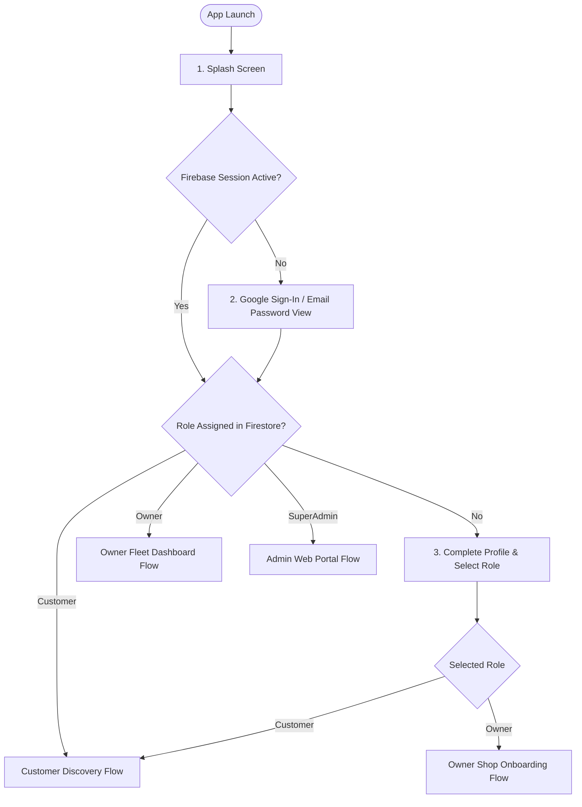
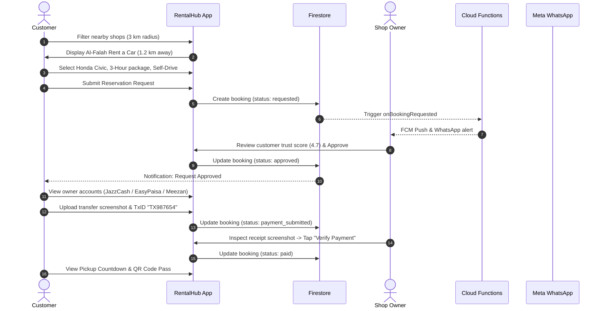
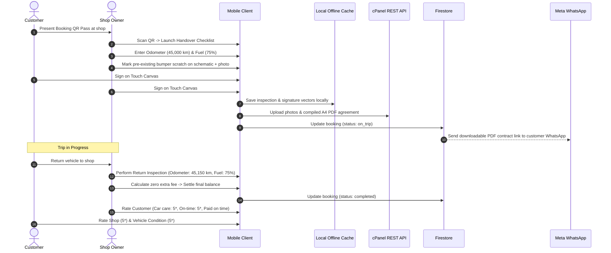

# DOC-4: App Flow Document
## Project: RentalHub (`rentalhub`)

---

## 1. Entry Points & Onboarding Routing Logic

RentalHub's client routing is governed by an automated entry state machine implemented in **GoRouter**:



---

## 2. Exhaustive Screen & Page Inventory

### 2.1 Customer App Screens (35 Screens)
*Directly mapped from `.ai/project_requirements_ui/Gaari-Customer-App-UI/`*

| Screen # | Screen Title | Route Path | Primary Actions & State Handlers |
| :--- | :--- | :--- | :--- |
| **01** | Splash Screen | `/splash` | Brand animation, connectivity check, session routing. |
| **02** | Sign In with Google | `/auth/login` | Google OAuth2 trigger, email/password fallback. |
| **03** | Complete Profile | `/onboarding/customer` | Full name, WhatsApp phone input (`+92`), profile photo upload. |
| **04** | Set Location Prompt | `/customer/location-prompt` | Location permission prompt, "Use My Current Location", manual override. |
| **05** | Location Permission Modal | Dialog | System permission dialog for foreground fine location. |
| **06** | Location Confirmed | `/customer/location-confirm` | Map view centering on user pin (e.g. Gulberg III, Lahore). |
| **07** | Nearby Shops (List View) | `/customer/home` | Radius pills (1 km, 2 km, 3 km, 5 km), shop cards, Call/WhatsApp. |
| **08** | Nearby Shops (Map View) | `/customer/home/map` | Interactive map markers, radius circle overlay, bottom preview card. |
| **09** | No Shop Found (Empty State)| Subview | Empty radar illustration, "Increase distance radius" button. |
| **10** | Shop Page | `/customer/shop/:id` | Shop cover, verified badge, operating hours, directions, reviews tab. |
| **11** | Available Cars | `/customer/shop/:id/cars`| Category tabs (All, Sedan, SUV, Hiace, Luxury), rate cards. |
| **12** | Car Detail View | `/customer/car/:id` | Photo carousel, engine specs, Self-Drive vs With-Driver rates. |
| **13** | Choose Rent Package | `/customer/book/:carId/pkg`| 1h, 3h, 6h, 24h packages, Self-Drive / With-Driver toggle. |
| **14** | Date & Time Picker | `/customer/book/:carId/time`| Calendar pickup/return selector, quantity stepper. |
| **15** | Review & Send Request | `/customer/book/:carId/review`| Rate summary, advance deposit notice, message for owner input. |
| **16** | Request Sent Confirmation | `/customer/book/success` | Success checkmark, "Waiting for owner approval", WhatsApp owner. |
| **17** | Request Approved Screen | `/customer/bookings/:id/approved`| Approved banner, owner payment breakdown, "Pay Advance" CTA. |
| **18** | Owner Payment Accounts | `/customer/payment/:id/accounts`| Copyable JazzCash, EasyPaisa, Bank Meezan IBAN details. |
| **19** | Upload Payment Proof | `/customer/payment/:id/upload` | Screenshot picker, Transaction ID input field, Submit button. |
| **20** | Pickup Countdown Pass | `/customer/bookings/:id/pass`| Live countdown timer, shop address, directions, digital QR pass. |
| **21** | Customer Home Dashboard | `/customer/dashboard` | Active booking card, stats (Trips, Spent), nearby top shops. |
| **22** | My Bookings | `/customer/bookings` | Segmented tabs: Pending, Approved, Active, Completed, Cancelled. |
| **23** | Wallet & Activity | `/customer/wallet` | Advance paid records, transaction logs, notification alerts. |
| **24** | Help & Support FAQ | `/customer/support` | Searchable FAQ items, Call Support, WhatsApp Support buttons. |
| **25** | Complaint / Dispute Filing | `/customer/dispute/new` | Issue tags (Damaged, Overcharged, Deposit), photo upload. |
| **26** | Rate Your Trip | `/customer/rate/:id` | Dual rating: Shop Service Stars + Car Condition Stars, comment. |
| **27** | Cancel Booking | `/customer/cancel/:id` | Cancellation policy terms, reason radio buttons, refund alert. |
| **28** | Customer Profile | `/customer/profile` | Avatar, verification badge, shortcuts to documents and saved shops. |
| **29** | My Documents (KYC) | `/customer/documents` | CNIC Front, CNIC Back, Driving License upload slots & status. |
| **30** | Saved Shops | `/customer/saved-shops` | Favorited rental shops list with quick contact buttons. |
| **31** | Settings | `/customer/settings` | English/Urdu bilingual toggle, notification toggles, delete account. |
| **32** | Emergency SOS | `/customer/sos` | Red SOS button, call owner, live location broadcast via WhatsApp. |
| **33** | Owner Rates Customer View | Read-only in profile | Display 4-dimensional owner feedback scores. |
| **34** | My Reputation | `/customer/reputation` | Trust Score (e.g. 4.7/5.0), breakdown bars, verified trip tags. |
| **35** | Customer Public Profile | Sheet | Viewable by owners during booking review (Trust score, KYC badge). |

---

### 2.2 Owner App Screens (Mapped from 72 Screens in UI Mockups)

| Flow Module | Screens Included | Primary Operations & State Handlers |
| :--- | :--- | :--- |
| **Step 1: Onboarding** | Screens 01–08 | Shop name, physical address, geo-pin, JazzCash/EasyPaisa/Meezan setup. |
| **Step 2: Fleet Management** | Screens 09–18 | Add vehicle, category, transmission, photos, 1h/3h/6h/24h rates. |
| **Step 2 Update: Rates** | Screens 19–24 | Configure In-City vs Out-of-City rates, Self-Drive vs With-Driver toggles. |
| **Step 3: Customer KYC** | Screens 25–28 | Scan walk-in customer CNIC/License, instant blacklist verification check. |
| **Step 4A: Online Requests**| Screens 29–34 | Incoming requests list, review customer trust score, Approve / Reject. |
| **Step 4B: Manual Booking** | Screens 35–40 | Walk-in reservation wizard, vehicle assignment, manual payment record. |
| **Step 4C: Handover** | Screens 41–48 | Odometer & fuel photo capture, 4-quadrant damage marker, dual touch signatures. |
| **Step 4C: Contract** | Screens 49–54 | On-device printable A4 PDF agreement generation, WhatsApp link delivery. |
| **Step 4D: Return** | Screens 55–60 | Check-in inspection, fuel/overtime balance calculation, settlement receipt. |
| **Step 4D: Rating** | Screens 61–64 | Rate customer (Car care, On-time, Payment, Behavior), quick tags. |
| **Step 5: Dashboard** | Screens 65–68 | Active rentals, available fleet, revenue cards, cash flow logs. |
| **Step 6: Subscription** | Screens 69–70 | Basic free tier (3 cars) indicator, upgrade to Pro/Enterprise. |
| **Step 7: WhatsApp Logs** | Screens 71–72 | Automated transactional WhatsApp dispatch logs. |

---

### 2.3 Super Admin Web Panel Screens (25 Desktop Screens)

| Section | Screens Included | Primary Operations & State Handlers |
| :--- | :--- | :--- |
| **Step 1: Dashboard** | Screens A1–A4 | Super admin login, platform KPIs, revenue chart, shop approval queue. |
| **Step 2: Directories** | Screens A5–A9 | Verified shop directory, customer registry, centralized Blacklist manager. |
| **Step 3: Oversight** | Screens A10–A15 | Global vehicle fleet monitor, booking logs, dispute arbitration tribunal. |
| **Step 4: Subscriptions** | Screens A16–A20 | Shop subscription plans, WhatsApp gateway credit monitoring. |
| **Step 5: Settings** | Screens A21–A25 | System broadcast push notifications, financial revenue reports. |

---

## 3. Primary User Journeys & State Transitions

### Journey 1: Customer Reservation & Advance Payment



---

### Journey 2: Vehicle Handover, Digital Signature & Return



---

## 4. Screen Action Matrices & Edge Cases

| Screen Trigger | User Input / Action | System Response | Edge Case Handling |
| :--- | :--- | :--- | :--- |
| **Discovery Radius** | Taps "5 km" pill | Re-queries Firestore with updated bounding box. | If zero shops in radius, display empty radar with "Increase distance" CTA. |
| **Direct WhatsApp** | Taps "WhatsApp Owner" | Checks `user.is_verified`. | If unverified, open modal: *"Verify your CNIC to unlock direct WhatsApp."* |
| **Payment Upload** | Uploads receipt & submits TxID | Uploads image to cPanel, sets `status: payment_submitted`. | If network drops, cache file locally and show: *"Upload queued, will sync online."* |
| **Payment Grace Window**| 60 minutes elapse without upload | Cloud Function scheduled job triggers. | Automatically transition booking to `status: cancelled_timeout`. |
| **Blacklist Report** | Owner submits fraud report | Saves to `blacklists`, sets customer `is_blacklisted: true`. | Silently flags customer profile across platform; no broadcast notification. |
| **Handover Signature** | User draws signature | Captures vector path coordinates in controller. | Disallow submission if canvas stroke count is zero. |
| **Emergency SOS** | Taps SOS button | Prompts immediate phone call to shop owner + WhatsApp GPS alert. | Works offline via native phone dialer fallback. |

---

## 5. Navigation Hierarchy & Route Map

```
/ (Root Redirect)
├── /splash
├── /auth
│   ├── /login
│   └── /forgot-password
├── /onboarding
│   ├── /role (Customer vs Owner - Locked)
│   └── /profile
│
├── /customer (ShellRoute with BottomNavigationBar)
│   ├── /home (Tab 0: Discovery Map & List)
│   ├── /shops (Tab 1: Shop Directory)
│   ├── /bookings (Tab 2: My Bookings - Pending/Approved/Active/Completed)
│   ├── /profile (Tab 3: Account, KYC Documents, Settings, SOS)
│   │
│   ├── /shop/:id (Detail Subroute)
│   ├── /car/:id (Vehicle Detail Subroute)
│   ├── /book/:id (Reservation Flow Subroute)
│   ├── /payment/:bookingId (Payment Proof Subroute)
│   ├── /agreement/:bookingId (Signed PDF Viewer Subroute)
│   └── /dispute/new (Complaint Subroute)
│
├── /owner (ShellRoute with Owner BottomNavigationBar)
│   ├── /dashboard (Tab 0: Fleet KPIs, Active Trips)
│   ├── /requests (Tab 1: Incoming Online Requests)
│   ├── /fleet (Tab 2: Car Inventory Management)
│   ├── /finance (Tab 3: Accounts & Cash Flow)
│   ├── /profile (Tab 4: Shop Settings, Payout Accounts, Subscription)
│   │
│   ├── /fleet/add (Add Vehicle Wizard)
│   ├── /manual-booking (Walk-in Customer Wizard)
│   ├── /handover/:bookingId (Inspection & Digital Signature Subroute)
│   ├── /return/:bookingId (Return Settlement Subroute)
│   └── /blacklist/report (Fraud Reporting Subroute)
│
└── /admin (Flutter Web Shell - Super Admin Only)
    ├── /login
    ├── /dashboard
    ├── /shops (Verification Queue)
    ├── /blacklist (Global Fraud Registry & Reversal)
    ├── /disputes (Tribunal)
    └── /subscriptions
```

---

## 6. Document Revision History
| Version | Date | Author / Agent | Change Type | Summary of Changes |
| :--- | :--- | :--- | :--- | :--- |
| **1.0.0** | 2026-10-31 | Lead Architect (Antigravity) | Initial Creation | Complete App Flow Document for RentalHub mapping all 35 customer and 72 owner screens. |
