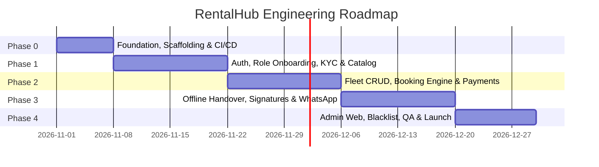
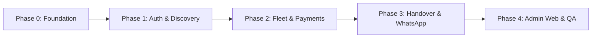

# DOC-5: Master Implementation Plan
## Project: RentalHub (`rentalhub`)

---

## 1. Phase Hierarchy & Timeline Overview

RentalHub's engineering roadmap is partitioned into five sequential, highly decoupled phases (Phase 0 through Phase 4). Each phase terminates in an unambiguous Definition of Done (DoD) and quality gate.

| Phase ID | Phase Name | Focus Area | Estimated Duration | Target Deliverable |
| :--- | :--- | :--- | :---: | :--- |
| **Phase 0** | Foundation & Architecture | Clean Architecture skeleton, DI, themes, cPanel client, routing | 1 Week | Runnable baseline app with design system & mock DI |
| **Phase 1** | Auth, Profiles & Discovery | Google/Email auth, role locking, KYC upload, shop exploration | 2 Weeks | End-to-end customer onboarding & shop exploration |
| **Phase 2** | Fleet & Booking Core | Vehicle CRUD, packages, booking requests, manual payment proof | 2 Weeks | Functional booking cycle with owner payment approval |
| **Phase 3** | Handover, Legal & WhatsApp | Offline inspection, touch signatures, A4 PDF, Meta WhatsApp API | 2 Weeks | Complete paperless contract handover & PDF delivery |
| **Phase 4** | Admin Web, QA & Release | Flutter Web on cPanel, blacklist manager, overflow tests, APK build | 1.5 Weeks | Production release APK & deployed cPanel Admin Web |

---

## 2. Inter-Phase Dependency Rules & Critical Path

### Dependency Rules:
1. **P0 Gate**: No feature code may be authored until the Dependency Injection (`get_it`), GoRouter shell, Light/Dark theme tokens, and cPanel HTTP client are fully integrated and unit tested.
2. **P1 Gate**: Fleet and booking modules (Phase 2) strictly depend on the immutable user role (`customer` vs `owner`) and verified shop profiles created in Phase 1.
3. **P2 Gate**: Vehicle handover and agreement generation (Phase 3) strictly require a booking in `status: paid` achieved through Phase 2's payment verification engine.
4. **P3 Gate**: Production deployment and admin dispute resolution (Phase 4) require signed contracts and live WhatsApp notification dispatches functioning in Phase 3.

---

## 3. High-Level Work Breakdown Structure (WBS)

### Phase 0: Environment, Architecture Foundation & External Services Provisioning
* Task 0.1: Git version control initialization, `.gitignore`, initial commit, and remote GitHub repository creation (`gh repo create rentalhub --private`).
* Task 0.2: Configure `pubspec.yaml` with locked dependencies (`flutter_bloc`, `get_it`, `go_router`, `firebase_core`, `hive`, etc.) and verify baseline builds.
* Task 0.3: Establish Clean Architecture directory scaffolding (`core/` and `features/`).
* Task 0.4: Implement global design tokens, light/dark themes, and `CustomCurvedHeader` dimensional widget matching Stitch ANC-01 / [ui_ref.jpg](file:///e:/Commercial/Gari%20App/.ai/project_requirements_ui/ui_ref.jpg).
* Task 0.5: Build cPanel secure upload REST client in Flutter (`CPanelStorageClient`) with HMAC-SHA256 token authentication.
* Task 0.6: Configure Dependency Injection graph (`get_it`) and GoRouter navigation base shell with role redirect stubs.
* Task 0.7: Establish automated widget test harness detecting UI overflows (360px viewport, 1.35x font scaling).
* Task 0.8: Firebase Project Setup & Android App Registration (`rentalhub-production`, `flutterfire configure`, debug/release SHA-1 fingerprint registration, and `google-services.json` injection).
* Task 0.9: cPanel Secure Storage Backend Deployment (Deploy `upload.php`, configure storage directories `public_html/storage/kyc/`, `payments/`, `agreements/`, enforce `.htaccess` execution prevention, and configure shared HMAC secret).

### Phase 1: Authentication, Role-Gating, KYC & Discovery
* Task 1.1: Firebase Auth integration (Google Sign-In with registered SHA-1 + Email/Password).
* Task 1.2: Single-role onboarding wizard with permanent Firestore role locking (`users/{uid}.role`).
* Task 1.3: Customer profile completion and verified-status badge evaluation (`is_verified`).
* Task 1.4: KYC document upload module (CNIC front/back, license) to cPanel storage endpoint `/storage/upload.php` (Stitch ANC-07).
* Task 1.5: Owner shop onboarding wizard with physical address, GPS coordinates, and payout accounts (JazzCash, EasyPaisa, Meezan) (Stitch ANC-09).
* Task 1.6: Geolocator integration and nearby shop discovery with 1–5 km radius filter (Stitch ANC-01).
* Task 1.7: Shop catalog, vehicle list view, and category filtering (Sedan/SUV/Hiace/Luxury).

### Phase 2: Fleet Management, Booking Engine & Manual Payments
* Task 2.1: Owner vehicle CRUD (photos, specifications, daily/hourly rates) with cPanel vehicle image hosting (Stitch ANC-11).
* Task 2.2: Rate schedule configuration (Self-Drive vs With-Driver, In-City vs Out-of-City) (Stitch ANC-12).
* Task 2.3: Freemium tier enforcement (hard limit of 3 vehicles for basic tier).
* Task 2.4: Customer reservation request flow (package selector, date/time picker, message) (Stitch ANC-02, ANC-04).
* Task 2.5: Owner incoming request triage (view customer trust score, approve/reject) (Stitch ANC-13).
* Task 2.6: Manual payment workflow (display owner accounts: JazzCash, EasyPaisa, Meezan) (Stitch ANC-03).
* Task 2.7: Payment proof upload (screenshot to cPanel `/storage/upload.php` + TxID) and owner verification action.
* Task 2.8: Active booking dashboard, pickup countdown timer, and digital QR pass (Stitch ANC-05, ANC-06).

### Phase 3: Offline Handover, Digital Legal Contract & Communications
* Task 3.1: QR code scanner integration for vehicle pickup check-in.
* Task 3.2: Local offline caching engine (Hive boxes for inspection drafts and sync queue).
* Task 3.3: Digital vehicle inspection checklist (fuel, odometer, 4-quadrant damage markers) (Stitch ANC-14).
* Task 3.4: On-screen dual touch signature capture canvas (Customer & Owner).
* Task 3.5: Printable A4 PDF rental agreement generator (`pdf` package) with embedded photos and vector signatures.
* Task 3.6: PDF upload to cPanel secure storage (`/storage/upload.php`, category: `agreements`) and tokenized link generation.
* Task 3.7: Background sync engine with connectivity listener for offline handovers.
* Task 3.8: Firebase Cloud Functions triggers (Node.js) for FCM push alerts on booking status changes.
* Task 3.9: Meta WhatsApp Cloud API integration in Cloud Functions for transactional PDF contract delivery.
* Task 3.10: Return inspection, settlement calculation, and dual-sided customer/owner ratings (Stitch ANC-08, ANC-15, ANC-16).

### Phase 4: Admin Web Panel, Blacklist Registry, Hardening & Release
* Task 4.1: Flutter Web project setup and cPanel static hosting configuration (`public_html/admin/` + `.htaccess` SPA rewrite rules).
* Task 4.2: Single `super_admin` authentication with Firebase Auth Custom Claims and route protection (Stitch ANC-17).
* Task 4.3: Shop verification review queue with document inspector (Stitch ANC-18).
* Task 4.4: Centralized fraud blacklist registry with instant reporting and admin revert controls (Stitch ANC-19).
* Task 4.5: Platform dispute tribunal and support ticket management (Stitch ANC-20).
* Task 4.6: Automated UI overflow testing harness (small viewports, font scaling at 1.35x, keyboards).
* Task 4.7: Button debounce verification and Firebase integration tests.
* Task 4.8: Complete bilingual localization audit (English LTR and Urdu RTL).
* Task 4.9: Production Android release APK compilation and cPanel Web deployment.

---

## 4. Major Milestones & Acceptance Deliverables

| Milestone | Target Date | Description | Verifiable Deliverable |
| :--- | :---: | :--- | :--- |
| **M0: Foundation Ready** | Day 7 | Base architecture, theme tokens, and routing active. | Clean build on Android & Web with passing DI tests. |
| **M1: Discovery Ready** | Day 21 | Auth, role locking, KYC, and nearby shop discovery. | User can log in, select role, and locate nearby shops on map. |
| **M2: Booking Ready** | Day 35 | Fleet management, booking requests, and manual payments. | End-to-end booking from request to payment verification. |
| **M3: Handover Ready** | Day 49 | Offline inspection, dual signatures, and WhatsApp PDF. | Complete offline contract signing and WhatsApp delivery. |
| **M4: Production Ready**| Day 59 | Admin Web, blacklist tribunal, QA tests passing. | Signed release APK + live deployed cPanel Admin Web. |

---

## 5. Risk Assessment & Mitigation Strategies

| Risk Description | Severity | Likelihood | Mitigation Strategy |
| :--- | :---: | :---: | :--- |
| **Offline Data Loss in Basements** | High | High | Implement local Hive persistence with atomic transactions; queue inspection state before attempting network calls. |
| **cPanel Upload Failures** | Medium | Medium | Implement automatic retry with exponential backoff; cache photos locally until HTTP 200 is confirmed. |
| **Meta WhatsApp Token Expiration** | High | Low | Store permanent System User Token in Google Cloud Secret Manager; implement Cloud Function token health alert. |
| **UI Overflow on Varied Devices** | Medium | High | Enforce automated widget test harness testing 360px widths, 1.35x font scaling, and active keyboard insets. |
| **Fraudulent Blacklist Abuse** | Medium | Medium | Blacklist reporting requires factual evidence photos; Super Admin possesses one-click reversal authority. |

---

## 6. Resource, Tooling & Environment Requirements

* **Development SDK**: Flutter 3.24.3+, Dart 3.5.3+, Android SDK 34 (API Level 34).
* **Cloud Services**: Google Firebase Project (Blaze Plan for Cloud Functions & Firestore).
* **Web Hosting**: cPanel hosting account supporting PHP 8.1+ with HTTPS SSL certificate and Apache `.htaccess` rewrite module.
* **Developer Accounts**: Google Cloud Console (Google Sign-In SHA-1), Meta for Developers (WhatsApp Cloud API App).
* **Testing Hardware**: Android physical test devices (Android 10 to 14) and virtual emulators (various screen aspect ratios).

---

## 7. Document Revision History
| Version | Date | Author / Agent | Change Type | Summary of Changes |
| :--- | :--- | :--- | :--- | :--- |
| **1.0.0** | 2026-10-31 | Lead Architect (Antigravity) | Initial Creation | Complete Master Implementation Plan for RentalHub across Phase 0 to Phase 4. |
| **1.1.0** | 2026-11-01 | Lead Architect (Antigravity) | Type C & Type J | Harmonized WBS with DOC-0 governance: explicitly added Git/GitHub repo setup, Firebase Project/Android registration, and cPanel backend deployment to Phase 0; mapped Stitch anchor screens ANC-01 through ANC-20 across Phases 1 to 4. |
