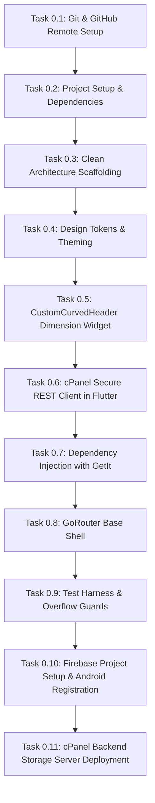

# DOC-7: Phase 0 Detailed Implementation Plan
## Environment, Architecture Foundation & Scaffolding
### Project: RentalHub (`rentalhub`)

---

## 1. Phase Objective & Definition of Done (DoD)

### 1.1 Objective
Establish the foundational engineering architecture, dependencies, directory scaffolding, Dependency Injection (DI) graph, design system tokens, cPanel secure storage REST client, GoRouter navigation tree, and automated testing harness for the **RentalHub** ecosystem.

### 1.2 Definition of Done (DoD)
- [ ] Git version control initialized (`.git`), production `.gitignore` configured, initial commit authored, and remote GitHub repository published (`gh repo create rentalhub --private`).
- [ ] Flutter 3.24+ project builds and runs cleanly on Android and Web targets without compiler warnings.
- [ ] Firebase project created (`rentalhub-production`), FlutterFire configured, Android app registered with debug/release SHA-1 certificate fingerprints, and `google-services.json` verified in `android/app/`.
- [ ] cPanel storage server environment deployed with PHP upload endpoint (`public_html/storage/upload.php`), directories initialized (`kyc/`, `payments/`, `agreements/`), secured with Apache `.htaccess` execution prevention, and verified with HMAC-SHA256 authentication.
- [ ] Clean Architecture folder structure (`core/` and `features/`) established with zero orphan files.
- [ ] Design system tokens (`AppTheme`, `AppColors`, typography, dimensions) implemented supporting seamless **Light and Dark** mode switching.
- [ ] `CustomCurvedHeader` widget rendered matching Stitch ANC-01 / [ui_ref.jpg](file:///e:/Commercial/Gari%20App/.ai/project_requirements_ui/ui_ref.jpg) dimensions.
- [ ] cPanel Secure REST API client configured in Flutter (`CPanelStorageClient`) with HMAC-SHA256 bearer token authentication.
- [ ] GoRouter configured with base route hierarchy, shell routes, and role redirect stubs.
- [ ] Automated widget test harness configured to detect UI overflows (small viewports, 1.35x font scaling).
- [ ] CI lint checks (`flutter analyze`) pass with zero errors and zero warnings.

---

## 2. Prerequisites & Tooling Setup

1. **Flutter SDK**: `3.24.3` or newer with Dart `3.5.3`.
2. **Android SDK**: API Level 34 (Android 14) platform tools and build tools installed.
3. **Git & GitHub CLI**: `git` 2.40+ and `gh` 2.50+ installed and authenticated.
4. **Firebase CLI**: `firebase-tools` v13.0+ configured with active project `rentalhub-production`.
5. **cPanel Hosting Account**: PHP 8.1+ with Apache `mod_rewrite`, HTTPS SSL certificate, and cPanel File Manager / SSH access.
6. **IDE & Extensions**: VS Code or Android Studio with Flutter, Dart, and Bloc extensions.

---

## 3. Detailed Task Breakdown & Implementation Steps



---

### Task 0.1: Git Version Control & GitHub Repository Setup
1. Initialize local Git repository in workspace root:
   ```powershell
   git init
   ```
2. Create comprehensive `.gitignore` safeguarding build artifacts, Gradle locks, and local configuration:
   ```gitignore
   # Flutter / Dart
   .dart_tool/
   .flutter-plugins
   .flutter-plugins-dependencies
   .packages
   build/
   
   # Android
   .gradle/
   **/android/.gradle_rh/
   local.properties
   **/android/app/debug/
   
   # Visual Studio Code / IDEs
   .idea/
   *.iml
   *.ipr
   *.iws
   .vscode/
   
   # Secrets & Credentials
   *.jks
   *.keystore
   **/android/key.properties
   ```
3. Commit Phase 0 scaffolding:
   ```powershell
   git add .
   git commit -m "feat(phase-0): initialize project scaffolding and architecture baseline"
   ```
4. Create and push to private GitHub repository using GitHub CLI (`gh`):
   ```powershell
   gh repo create rentalhub --private --source=. --remote=origin --push
   ```

---

### Task 0.2: Project Setup & Dependency Configuration
Configure `pubspec.yaml` with the exact verified dependencies referenced from `E:\Commercial\RentACar\pubspec.yaml`:

```yaml
name: rentalhub
description: "Enterprise Car Rental Marketplace and Fleet Management Platform."
publish_to: 'none'
version: 1.0.0+1

environment:
  sdk: ^3.5.0
  flutter: ">=3.24.0"

dependencies:
  flutter:
    sdk: flutter
  flutter_localizations:
    sdk: flutter
  cupertino_icons: ^1.0.8

  # State Management & DI
  flutter_bloc: ^9.1.1
  get_it: ^9.3.0

  # Routing
  go_router: ^18.1.0

  # Firebase Suite
  firebase_core: ^5.0.0
  firebase_auth: ^7.0.0
  cloud_firestore: ^7.0.0
  cloud_functions: ^7.0.0
  firebase_messaging: ^15.0.0
  google_sign_in: ^7.2.0

  # Storage & Offline Cache
  shared_preferences: ^2.5.6
  flutter_secure_storage: ^11.2.0
  hive: ^2.2.3
  hive_flutter: ^1.1.0

  # Networking & Media
  http: ^1.6.0
  cached_network_image: ^4.0.3
  image_picker: ^1.2.4
  permission_handler: ^13.0.2

  # Location & Hardware
  geolocator: ^14.0.0
  google_mlkit_text_recognition: ^0.13.0
  google_mlkit_barcode_scanning: ^0.12.1

  # PDF & Digital Contracts
  pdf: ^3.11.1
  printing: ^5.13.2

  # Internationalization & UI
  intl: ^0.20.2
  font_awesome_flutter: ^11.0.0

dev_dependencies:
  flutter_test:
    sdk: flutter
  flutter_lints: ^6.0.0
  fake_cloud_firestore: ^3.1.0
  mockito: ^5.4.4
  build_runner: ^2.4.12
  hive_generator: ^2.0.1
```

---

### Task 0.3: Directory Scaffolding
Create the directory structure inside `lib/`:

```
lib/
├── core/
│   ├── constants/
│   │   ├── app_colors.dart
│   │   ├── app_dimensions.dart
│   │   └── api_endpoints.dart
│   ├── di/
│   │   └── injection_container.dart
│   ├── error/
│   │   ├── exceptions.dart
│   │   └── failures.dart
│   ├── network/
│   │   ├── api_client.dart
│   │   └── cpanel_storage_client.dart
│   ├── routing/
│   │   ├── app_router.dart
│   │   └── route_names.dart
│   ├── theme/
│   │   ├── app_theme.dart
│   │   ├── color_palette.dart
│   │   └── typography.dart
│   └── widgets/
│       ├── custom_curved_header.dart
│       ├── debounced_button.dart
│       ├── verified_badge.dart
│       └── app_text_field.dart
└── features/
    ├── auth/
    ├── discovery/
    ├── fleet/
    ├── bookings/
    ├── payments/
    ├── handover/
    ├── trust/
    ├── blacklist/
    ├── subscription/
    └── admin/
```

---

### Task 0.4: Global Design Tokens & Theming (`AppTheme`)
Implement the unified Light and Dark theme configurations in `lib/core/theme/app_theme.dart`:

```dart
import 'package:flutter/material.dart';

class AppColors {
  static const Color primaryDark = Color(0xFF16194F);
  static const Color primary = Color(0xFF1B1E5C);
  static const Color primaryLight = Color(0xFFEEF0FF);
  static const Color secondary = Color(0xFFF95700);
  static const Color secondaryLight = Color(0xFFFFF3EB);
  static const Color backgroundLight = Color(0xFFF8FAFC);
  static const Color backgroundDark = Color(0xFF0A0B1A);
  static const Color surfaceLight = Color(0xFFFFFFFF);
  static const Color surfaceDark = Color(0xFF13152C);
  static const Color textPrimaryLight = Color(0xFF0F172A);
  static const Color textPrimaryDark = Color(0xFFF8FAFC);
  static const Color error = Color(0xFFEF4444);
  static const Color success = Color(0xFF10B981);
}

class AppTheme {
  static ThemeData get lightTheme {
    return ThemeData(
      useMaterial3: true,
      brightness: Brightness.light,
      primaryColor: AppColors.primary,
      scaffoldBackgroundColor: AppColors.backgroundLight,
      colorScheme: const ColorScheme.light(
        primary: AppColors.primary,
        secondary: AppColors.secondary,
        surface: AppColors.surfaceLight,
        error: AppColors.error,
      ),
      fontFamily: 'Inter',
      elevatedButtonTheme: ElevatedButtonThemeData(
        style: ElevatedButton.styleFrom(
          backgroundColor: AppColors.secondary,
          foregroundColor: Colors.white,
          minimumSize: const Size(double.infinity, 54),
          shape: RoundedRectangleBorder(borderRadius: BorderRadius.circular(16)),
        ),
      ),
    );
  }

  static ThemeData get darkTheme {
    return ThemeData(
      useMaterial3: true,
      brightness: Brightness.dark,
      primaryColor: AppColors.secondary,
      scaffoldBackgroundColor: AppColors.backgroundDark,
      colorScheme: const ColorScheme.dark(
        primary: AppColors.secondary,
        secondary: AppColors.primary,
        surface: AppColors.surfaceDark,
        error: AppColors.error,
      ),
      fontFamily: 'Inter',
      elevatedButtonTheme: ElevatedButtonThemeData(
        style: ElevatedButton.styleFrom(
          backgroundColor: AppColors.secondary,
          foregroundColor: Colors.white,
          minimumSize: const Size(double.infinity, 54),
          shape: RoundedRectangleBorder(borderRadius: BorderRadius.circular(16)),
        ),
      ),
    );
  }
}
```

---

### Task 0.5: `CustomCurvedHeader` Dimensional Widget
Implement the curved app bar conforming to `ui_ref.jpg` in `lib/core/widgets/custom_curved_header.dart`:

```dart
import 'package:flutter/material.dart';
import '../theme/app_theme.dart';

class CustomCurvedHeader extends StatelessWidget {
  final Widget titleWidget;
  final Widget? leadingWidget;
  final List<Widget>? actions;
  final Widget? bottomWidget;
  final double height;

  const CustomCurvedHeader({
    super.key,
    required this.titleWidget,
    this.leadingWidget,
    this.actions,
    this.bottomWidget,
    this.height = 230.0,
  });

  @override
  Widget build(BuildContext context) {
    final topPadding = MediaQuery.of(context).padding.top;
    final isDark = Theme.of(context).brightness == Brightness.dark;

    return Container(
      width: double.infinity,
      height: height + topPadding,
      padding: EdgeInsets.only(
        top: topPadding + 12,
        left: 20,
        right: 20,
        bottom: 24,
      ),
      decoration: BoxDecoration(
        gradient: LinearGradient(
          begin: Alignment.topLeft,
          end: Alignment.bottomRight,
          colors: isDark
              ? [const Color(0xFF0B0D26), const Color(0xFF16194F)]
              : [AppColors.primaryDark, const Color(0xFF242875)],
        ),
        borderRadius: const BorderRadius.vertical(
          bottom: Radius.circular(28),
        ),
        boxShadow: [
          BoxShadow(
            color: Colors.black.withOpacity(0.12),
            blurRadius: 16,
            offset: const Offset(0, 8),
          ),
        ],
      ),
      child: Column(
        crossAxisAlignment: CrossAxisAlignment.start,
        children: [
          Row(
            children: [
              if (leadingWidget != null) leadingWidget!,
              const SizedBox(width: 12),
              Expanded(child: titleWidget),
              if (actions != null) ...actions!,
            ],
          ),
          if (bottomWidget != null) ...[
            const Spacer(),
            bottomWidget!,
          ],
        ],
      ),
    );
  }
}
```

---

### Task 0.6: cPanel Secure REST Storage Client in Flutter
Implement `CPanelStorageClient` with HMAC-SHA256 bearer tokens in `lib/core/network/cpanel_storage_client.dart`:

```dart
import 'dart:convert';
import 'dart:io';
import 'package:crypto/crypto.dart';
import 'package:http/http.dart' as http;
import '../error/exceptions.dart';

class CPanelStorageClient {
  final String baseUrl;
  final String apiSecretKey;

  CPanelStorageClient({
    required this.baseUrl,
    required this.apiSecretKey,
  });

  String _generateAuthToken(String userUid) {
    final timestamp = DateTime.now().millisecondsSinceEpoch.toString();
    final message = '$userUid:$timestamp';
    final hmac = Hmac(sha256, utf8.encode(apiSecretKey));
    final digest = hmac.convert(utf8.encode(message));
    return '$message:${digest.toString()}';
  }

  Future<String> uploadFile({
    required File file,
    required String userUid,
    required String folder, // e.g. 'kyc', 'payments', 'agreements'
  }) async {
    final uri = Uri.parse('$baseUrl/api/upload.php');
    final request = http.MultipartRequest('POST', uri)
      ..headers['Authorization'] = 'Bearer ${_generateAuthToken(userUid)}'
      ..fields['folder'] = folder
      ..files.add(await http.MultipartFile.fromPath('media_file', file.path));

    final response = await request.send();
    final responseBody = await response.stream.bytesToString();

    if (response.statusCode == 200) {
      final json = jsonDecode(responseBody);
      return json['file_key'] as String; // e.g. 'kyc/cnic_front_123.jpg'
    } else {
      throw ServerException(message: 'cPanel upload failed: $responseBody');
    }
  }
}
```

---

### Task 0.7: Dependency Injection Setup (`get_it`)
Initialize global singletons in `lib/core/di/injection_container.dart`:

```dart
import 'package:get_it/get_it.dart';
import 'package:shared_preferences/shared_preferences.dart';
import '../network/cpanel_storage_client.dart';

final sl = GetIt.instance;

Future<void> initCoreDI() async {
  // External
  final sharedPreferences = await SharedPreferences.getInstance();
  sl.registerLazySingleton<SharedPreferences>(() => sharedPreferences);

  // Network & Storage
  sl.registerLazySingleton<CPanelStorageClient>(() => CPanelStorageClient(
    baseUrl: 'https://storage.rentalhub.pk',
    apiSecretKey: 'RENTALHUB_HMAC_SECRET_STUB',
  ));
}
```

---

### Task 0.8: Base Routing Configuration (`go_router`)
Configure root router in `lib/core/routing/app_router.dart`:

```dart
import 'package:flutter/material.dart';
import 'package:go_router/go_router.dart';

class AppRouter {
  static final GoRouter router = GoRouter(
    initialLocation: '/splash',
    routes: [
      GoRoute(
        path: '/splash',
        builder: (context, state) => const Scaffold(
          body: Center(child: Text('RentalHub Splash')),
        ),
      ),
      GoRoute(
        path: '/auth',
        builder: (context, state) => const Scaffold(
          body: Center(child: Text('Login View')),
        ),
      ),
      GoRoute(
        path: '/customer/home',
        builder: (context, state) => const Scaffold(
          body: Center(child: Text('Customer Home')),
        ),
      ),
      GoRoute(
        path: '/owner/dashboard',
        builder: (context, state) => const Scaffold(
          body: Center(child: Text('Owner Dashboard')),
        ),
      ),
    ],
  );
}
```

---

### Task 0.9: Automated Test Harness (Overflow Protection)
Configure `test/test_helper.dart` to simulate edge viewport constraints:

```dart
import 'package:flutter/material.dart';
import 'package:flutter_test/flutter_test.dart';

class TestHarness {
  static Future<void> pumpScreenWithOverflowCheck({
    required WidgetTester tester,
    required Widget screen,
    double width = 360.0,
    double height = 640.0,
    double textScale = 1.35,
  }) async {
    tester.view.physicalSize = Size(width * 2, height * 2);
    tester.view.devicePixelRatio = 2.0;

    await tester.pumpWidget(
      MaterialApp(
        home: MediaQuery(
          data: MediaQueryData(
            size: Size(width, height),
            textScaler: TextScaler.linear(textScale),
          ),
          child: screen,
        ),
      ),
    );
    await tester.pumpAndSettle();

    // Verify zero overflow exceptions
    expect(tester.takeException(), isNull);
  }
}
```

---

### Task 0.10: Firebase Project Provisioning & Android App Registration

1. **Firebase Project Creation**:
   Ensure Firebase CLI is authenticated and create the production project:
   ```powershell
   firebase login
   firebase projects:create rentalhub-production --display-name "RentalHub"
   ```

2. **FlutterFire CLI Configuration**:
   Bind the Flutter app to Firebase across Android and Web platforms:
   ```powershell
   dart pub global activate flutterfire_cli
   flutterfire configure --project=rentalhub-production --platforms=android,web --android-package-name=com.rentalhub.app -y
   ```
   This generates `lib/firebase_options.dart` and places `android/app/google-services.json`.

3. **Android SHA-1 Certificate Fingerprint Registration**:
   Extract debug signing certificate SHA-1 and SHA-256 fingerprints:
   ```powershell
   cd android
   .\gradlew.bat signingReport
   ```
   Register the `debug` and release SHA-1 fingerprints in the Firebase Console under **Project Settings > Android Apps (`com.rentalhub.app`) > SHA certificate fingerprints**. This is mandatory for Google Sign-In to function without `ApiException: 10` errors in Phase 1.

4. **Verify Firebase Initialization**:
   Update `lib/main.dart` to ensure Firebase initializes asynchronously before runApp:
   ```dart
   import 'package:flutter/material.dart';
   import 'package:firebase_core/firebase_core.dart';
   import 'firebase_options.dart';

   void main() async {
     WidgetsFlutterBinding.ensureInitialized();
     await Firebase.initializeApp(
       options: DefaultFirebaseOptions.currentPlatform,
     );
     runApp(const MyApp());
   }
   ```

---

### Task 0.11: cPanel Backend Storage Server Deployment & Security

1. **Storage Directory Hierarchy Setup on cPanel**:
   Under the cPanel hosting root (`public_html/storage/`), establish isolated directories:
   ```text
   public_html/
   └── storage/
       ├── upload.php          <-- Authenticated upload receiver
       ├── .htaccess           <-- Security locks
       ├── kyc/                <-- Private CNIC & driving licenses (Phase 1)
       ├── vehicles/           <-- Public vehicle fleet photos (Phase 2)
       ├── payments/           <-- Private bank transfer receipts (Phase 2)
       └── agreements/         <-- Private signed A4 PDF contracts (Phase 3)
   ```

2. **Deploying `upload.php` Script**:
   Create `public_html/storage/upload.php` to validate HMAC-SHA256 headers before saving files:
   ```php
   <?php
   header('Content-Type: application/json');

   // Secret key matched identically with Flutter App & Cloud Functions
   $SECRET_KEY = getenv('CPANEL_HMAC_SECRET') ?: 'RENTALHUB_HMAC_SECURE_STORAGE_SECRET_2026';

   $authHeader = $_SERVER['HTTP_AUTHORIZATION'] ?? '';
   if (!preg_match('/^Bearer\s+(.+)$/i', $authHeader, $matches)) {
       http_response_code(401);
       echo json_encode(['error' => 'Missing or malformed Authorization header']);
       exit;
   }

   $token = $matches[1];
   $tokenParts = explode(':', base64_decode($token));
   if (count($tokenParts) !== 2) {
       http_response_code(401);
       echo json_encode(['error' => 'Invalid token structure']);
       exit;
   }

   list($timestamp, $receivedHash) = $tokenParts;
   // Enforce 300-second token expiration window against replay attacks
   if (abs(time() - intval($timestamp)) > 300) {
       http_response_code(403);
       echo json_encode(['error' => 'Token expired']);
       exit;
   }

   $expectedHash = hash_hmac('sha256', $timestamp, $SECRET_KEY);
   if (!hash_equals($expectedHash, $receivedHash)) {
       http_response_code(403);
       echo json_encode(['error' => 'Invalid HMAC signature']);
       exit;
   }

   // Validate Category
   $category = $_POST['category'] ?? 'kyc';
   $allowedCategories = ['kyc', 'vehicles', 'payments', 'agreements'];
   if (!in_array($category, $allowedCategories)) {
       http_response_code(400);
       echo json_encode(['error' => 'Invalid category specified']);
       exit;
   }

   // File Upload Validation
   if (!isset($_FILES['file']) || $_FILES['file']['error'] !== UPLOAD_ERR_OK) {
       http_response_code(400);
       echo json_encode(['error' => 'File upload error or file missing']);
       exit;
   }

   $file = $_FILES['file'];
   $allowedMimeTypes = ['image/jpeg', 'image/png', 'image/webp', 'application/pdf'];
   $finfo = finfo_open(FILEINFO_MIME_TYPE);
   $detectedMime = finfo_file($finfo, $file['tmp_name']);
   finfo_close($finfo);

   if (!in_array($detectedMime, $allowedMimeTypes)) {
       http_response_code(415);
       echo json_encode(['error' => 'Unsupported Media Type']);
       exit;
   }

   // Max 10MB file size limit
   if ($file['size'] > 10 * 1024 * 1024) {
       http_response_code(413);
       echo json_encode(['error' => 'Payload exceeds maximum allowed size (10MB)']);
       exit;
   }

   $extension = pathinfo($file['name'], PATHINFO_EXTENSION);
   $sanitizedName = bin2hex(random_bytes(16)) . '.' . $extension;
   $targetDirectory = __DIR__ . '/' . $category . '/';
   $targetPath = $targetDirectory . $sanitizedName;

   if (!is_dir($targetDirectory)) {
       mkdir($targetDirectory, 0755, true);
   }

   if (move_uploaded_file($file['tmp_name'], $targetPath)) {
       $protocol = (!empty($_SERVER['HTTPS']) && $_SERVER['HTTPS'] !== 'off') ? "https://" : "http://";
       $publicUrl = $protocol . $_SERVER['HTTP_HOST'] . '/storage/' . $category . '/' . $sanitizedName;
       http_response_code(200);
       echo json_encode([
           'success' => true,
           'url' => $publicUrl,
           'filename' => $sanitizedName,
           'category' => $category,
           'size' => $file['size']
       ]);
   } else {
       http_response_code(500);
       echo json_encode(['error' => 'Failed to persist uploaded asset']);
   }
   ?>
   ```

3. **Apache `.htaccess` Hardening**:
   Create `public_html/storage/.htaccess` to prevent script execution vulnerabilities:
   ```apache
   # Prevent PHP script execution inside upload folders
   <FilesMatch "\.(php|phtml|php3|php4|php5|php7|phps|cgi|pl|sh)$">
       Order Deny,Allow
       Deny from all
   </FilesMatch>

   # Prevent directory listing
   Options -Indexes
   ```

---

## 4. Phase 0 Quality Gates & Verification Checklist

- [ ] Git repository initialized, `.gitignore` validated, and initial commit pushed to remote GitHub repository (`rentalhub`).
- [ ] `flutter pub get` completes with zero dependency conflicts.
- [ ] `flutter analyze --fatal-infos` returns zero issues.
- [ ] `flutter test` executes `TestHarness` with zero errors.
- [ ] Firebase project `rentalhub-production` provisioned with `google-services.json` in `android/app/` and SHA-1 registered.
- [ ] cPanel storage server deployed at `https://<domain>/storage/upload.php` with HMAC-SHA256 authorization and `.htaccess` execution locks verified.
- [ ] `CustomCurvedHeader` visual layout renders properly matching Stitch ANC-01 in both light and dark themes.
- [ ] Directory architecture matches Section 0.3 without violation.

---

## 5. Document Revision History
| Version | Date | Author / Agent | Change Type | Summary of Changes |
| :--- | :--- | :--- | :--- | :--- |
| **1.0.0** | 2026-10-31 | Lead Architect (Antigravity) | Initial Creation | Complete Phase 0 Detailed Implementation Plan for RentalHub. |
| **1.1.0** | 2026-11-01 | Lead Architect (Antigravity) | Type C & Type J | Added explicit Task 0.1 (Git & GitHub remote setup), Task 0.10 (Firebase Project & Android SHA-1 registration), and Task 0.11 (cPanel Backend Storage deployment, HMAC verification script, directory hierarchy, and .htaccess security); mapped Stitch ANC-01 tokens. |
